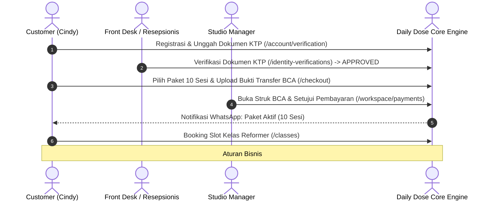
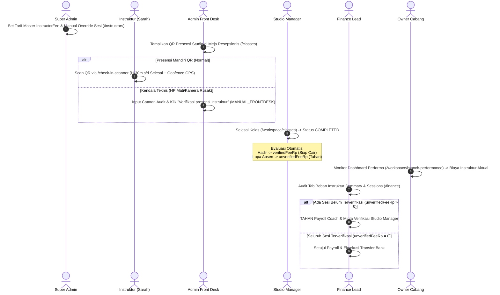

# 📘 DOKUMEN MASTER INDEX & PANDUAN TATA KELOLA UAT MULTI-ROLE
## Platform: Daily Dose Pilates Studio Management System v2.0
**Kode Dokumen:** `DOC-UAT-DDV2-HUB-INDEX-2026`  
**Status Dokumen:** `CANONICAL MASTER HUB`  
**Target Lingkungan:** Web App `http://localhost:32120` | REST API `http://localhost:32121` | MySQL Database `dailydose_v2_uat`  
**Penyusun:** Lead QA & Orang Awam Testing Team  
**Kepatuhan:** 100% Presisi dengan Rute Next.js 15, Controller NestJS 11, dan 13 Keputusan Bisnis Terkunci (*Locked Business Decisions*)

---

## 1. Pendekatan Modular Hub & Spoke UAT

Untuk memastikan pengujian UAT dapat dilakukan secara menyeluruh tanpa ada alur mikroskopis yang terpotong oleh limitasi panjang dokumen, dokumentasi UAT Daily Dose Pilates V2 mengadopsi **Arsitektur Modular Hub & Spoke**:

* **Dokumen Master Hub (Berkas Ini):** Berfungsi sebagai peta navigasi global, matriks kredensial uji, katalog aturan bisnis yang terkunci, serta lembar kendali eksekusi menyeluruh.
* **7 Dedicated Role Runbooks (Subdirektori `roles/`):** Buku panduan kerja (*runbook*) spesifik per peran pengguna. Setiap buku panduan memuat langkah klik-demi-klik (*click-by-click*), URL persis, data uji nyata (*test data*), tangkapan visual, dan skenario *Happy Path* serta *No-Happy Path / Adversarial* yang sangat mendalam.

```
docs/uat/
├── DOKUMEN_MASTER_UAT_INDEX.md                   <-- [MASTER HUB] Peta navigasi global & sign-off
└── roles/
    ├── UAT_ROLE_1_SUPER_ADMIN.md                 <-- Tata kelola global, paket, jadwal, KYC, tarif honor
    ├── UAT_ROLE_2_OWNER_CABANG.md                <-- Omset cabang, audit biaya instruktur, isolasi cabang
    ├── UAT_ROLE_3_STUDIO_MANAGER.md              <-- Anti-blind approval bayar, maker-checker, selesai kelas
    ├── UAT_ROLE_4_ADMIN_FRONT_DESK.md            <-- Drawer walk-in, assisted sale, display QR, verifikasi manual coach
    ├── UAT_ROLE_5_INSTRUCTOR_COACH.md            <-- Scan QR studio, geofence GPS, akumulasi honor, kasus lupa absen
    ├── UAT_ROLE_6_FINANCE_LEAD.md                <-- Rekonsiliasi BCA, voucher, audit beban instruktur, penahanan payroll
    └── UAT_ROLE_7_CUSTOMER_MEMBER.md             <-- Registrasi KTP, self-booking, aturan saldo sesi, reschedule H-24
```

---

## 2. Matriks 7 Peran Pengguna & Kredensial Uji Otentik

Seluruh akun di bawah ini telah diverifikasi aktif pada database UAT dan siap digunakan untuk pengujian peran:

| Peran (*Role*) | Akun Login UAT | Password Default | Lingkup Otoritas Cabang | Berkas Panduan Pengujian Detail |
| :--- | :--- | :--- | :--- | :--- |
| **Super Admin / Super Owner** | `ralamzah@gmail.com` / `superowner@dailydose.test` | `ridho123` / `SuperOwner123!` | Global (Seluruh Cabang) | [roles/UAT_ROLE_1_SUPER_ADMIN.md](file:///Users/lrmcorporation/Documents/Website/dailydose_v2/docs/uat/roles/UAT_ROLE_1_SUPER_ADMIN.md) |
| **Owner Cabang (Mitra)** | `owner.gg@dailydose.test` | `ridho123` / `Owner123!` | Terbatas Cabang Green Garden (`DD-GG`) | [roles/UAT_ROLE_2_OWNER_CABANG.md](file:///Users/lrmcorporation/Documents/Website/dailydose_v2/docs/uat/roles/UAT_ROLE_2_OWNER_CABANG.md) |
| **Studio Manager** | `manager.gg@dailydose.test` | `ridho123` / `Manager123!` | Cabang Green Garden (`DD-GG`) | [roles/UAT_ROLE_3_STUDIO_MANAGER.md](file:///Users/lrmcorporation/Documents/Website/dailydose_v2/docs/uat/roles/UAT_ROLE_3_STUDIO_MANAGER.md) |
| **Admin Front Desk** | `admin.gg@dailydose.test` / `adminmk@ddose.com` | `ridho123` / `Admin123!` | Cabang Green Garden / Muara Karang | [roles/UAT_ROLE_4_ADMIN_FRONT_DESK.md](file:///Users/lrmcorporation/Documents/Website/dailydose_v2/docs/uat/roles/UAT_ROLE_4_ADMIN_FRONT_DESK.md) |
| **Instruktur / Coach** | `coach.sarah@dailydose.test` / `instdevi@ddose.com` | `ridho123` / `Instructor123!` | Cabang Penugasan (Green Garden) | [roles/UAT_ROLE_5_INSTRUCTOR_COACH.md](file:///Users/lrmcorporation/Documents/Website/dailydose_v2/docs/uat/roles/UAT_ROLE_5_INSTRUCTOR_COACH.md) |
| **Finance Lead** | `finance@dailydose.test` | `ridho123` / `Finance123!` | Global (Semua Cabang) | [roles/UAT_ROLE_6_FINANCE_LEAD.md](file:///Users/lrmcorporation/Documents/Website/dailydose_v2/docs/uat/roles/UAT_ROLE_6_FINANCE_LEAD.md) |
| **Customer / Member** | `cindyedelene@gmail.com` / `clara.new@dailydose.test` | `ridho123` / `MemberBaru2026!` | Pelanggan Studio | [roles/UAT_ROLE_7_CUSTOMER_MEMBER.md](file:///Users/lrmcorporation/Documents/Website/dailydose_v2/docs/uat/roles/UAT_ROLE_7_CUSTOMER_MEMBER.md) |

---

## 3. Peta Arsitektur 10 Modul Inti & Rute Antarmuka Web

```
┌────────────────────────────────────────────────────────────────────────────────────────┐
│                        PETA 10 MODUL INTI DAILY DOSE PILATES V2                        │
├──────────────────────────┬──────────────────────────┬──────────────────────────────────┤
│ 1. OTENTIKASI & KEAMANAN │ 2. MASTER DATA & CABANG  │ 3. KATALOG PAKET & PROMOSI       │
│    /sign-in, /register   │    /workspace/branches   │    /packages, /workspace/packages│
│    /account/verification │    /locations, /master   │    /workspace/vouchers           │
├──────────────────────────┼──────────────────────────┼──────────────────────────────────┤
│ 4. PENJADWALAN KELAS     │ 5. PEMESANAN KELAS       │ 6. PRESENSI KEHADIRAN GANDA      │
│    /workspace/classes    │    /classes, /bookings   │    /check-in-scanner             │
│    /schedule, /classes   │    /checkout, /orders    │    /check-in/[token]             │
├──────────────────────────┼──────────────────────────┼──────────────────────────────────┤
│ 7. PENYESUAIAN SESI      │ 8. VERIFIKASI PEMBAYARAN │ 9. FINANSIAL & TUTUP BUKU        │
│    /ledger/adjustments   │    /workspace/payments   │    /finance, /workspace/branch-  │
│    /ledger               │    (Maker-Checker Guard) │    performance, /monthly-closes  │
├──────────────────────────┴──────────────────────────┴──────────────────────────────────┤
│ 10. OTOMASI SISTEM, WORKER CRON & NOTIFIKASI WHATSAPP                                  │
│     /workspace/reminders, /support-cases, Auto-Cancel H-24, Zero-Spam Member Berhenti  │
└────────────────────────────────────────────────────────────────────────────────────────┘
```

---

## 4. Alur Integrasi End-to-End Lintas Peran (Cross-Role Lifecycle)

Setiap transaksi di Daily Dose Pilates melibatkan kolaborasi terpadu antar-peran. Diagram berikut mengilustrasikan dua rantai alur paling krusial:

### Rantai A: Pembelian Paket & Booking Kelas Mandiri


### Rantai B: Siklus Absensi Instruktur, Selesai Kelas & Penggajian Payroll


---

## 5. Ringkasan 13 Aturan Bisnis Terkunci (*Locked Business Decisions*)

Setiap skenario pengujian di seluruh berkas peran mengacu pada aturan bisnis ini:

1. **Rule #1 (Saldo Sesi Pemesanan):** Booking kelas **TIDAK** memotong saldo paket saat dipesan. Pemotongan saldo baru terjadi saat kelas dinyatakan `COMPLETED` (`ATTEND` = potong 1 sesi, `NO_SHOW` = hangus 1 sesi).
2. **Rule #2 (Reschedule Mandiri):** Member berhak reschedule mandiri jika dilakukan minimal H-24 jam sebelum kelas dimulai (`>= H-24`).
3. **Rule #3 (Kompensasi Medis):** Pembatalan darurat `< H-24` hanya dapat dikompensasikan melalui persetujuan Studio Manager dengan bukti surat keterangan dokter (`SessionAdjustRequest`).
4. **Rule #4 (Maker-Checker Keuangan):** Staf yang mencatat transaksi penjualan dilarang menyetujui transaksi pembayarannya sendiri.
5. **Rule #5 (Anti-Blind Review):** Tombol *"Setujui pembayaran"* terkunci otomatis sampai staf membuka dan meninjau foto bukti transfer bank.
6. **Rule #6 (Tutup Buku Bulanan):** Setelah periode pembukuan berstatus `LOCKED`, seluruh mutasi keuangan lampau terkunci secara absolut (*immutable*).
7. **Rule #7 (Geofence GPS Studio):** Presensi scan QR instruktur wajib berada dalam radius geofence studio cabang bersangkutan.
8. **Rule #8 (Jendela Waktu Presensi Instruktur):** Presensi QR instruktur hanya dibuka mulai H-30 menit sebelum kelas dimulai hingga jam selesai kelas.
9. **Rule #9 (Backfill Cutoff H+2 Jam):** Presensi susulan oleh Front Desk dibatasi maksimal 2 jam setelah kelas berakhir (`H+2 jam`).
10. **Rule #10 (Isolasi Data Multi-Cabang):** Owner dan staf cabang Green Garden dilarang melihat data omset atau jadwal cabang Muara Karang / Surabaya (`403 Forbidden`).
11. **Rule #11 (Zero-Spam Member Berhenti):** Member yang telah berstatus berhenti (`stoppedAt != null`) otomatis dikecualikan dari antrean pesan promosi WhatsApp.
12. **Rule #12 (Pemilahan Honor Instruktur Berbasis Kehadiran):** Sesi selesai berstatus hadir masuk ke `verifiedFeeRp` (siap cair); sesi tanpa presensi masuk ke `unverifiedFeeRp` (ditahan dari pencairan payroll).
13. **Rule #13 (Fallback Tarif Aman):** Instruktur baru tanpa konfigurasi tarif master otomatis menggunakan tarif default Rp 150.000/jam bertanda `configured = false`.

---

## 6. Indeks Berkas Panduan Pengujian Dedicated Roles (`roles/`)

Silakan buka berkas pengujian spesifik per peran untuk melihat langkah klik-demi-klik yang sangat detail:

1. [roles/UAT_ROLE_1_SUPER_ADMIN.md](file:///Users/lrmcorporation/Documents/Website/dailydose_v2/docs/uat/roles/UAT_ROLE_1_SUPER_ADMIN.md): Pengawasan multi-cabang, timetable collision guard, duplikasi paket, KYC member, konfigurasi master tarif honor.
2. [roles/UAT_ROLE_2_OWNER_CABANG.md](file:///Users/lrmcorporation/Documents/Website/dailydose_v2/docs/uat/roles/UAT_ROLE_2_OWNER_CABANG.md): Laporan omset, kartu Biaya Instruktur Aktual, warning honor belum terverifikasi, isolasi multi-cabang.
3. [roles/UAT_ROLE_3_STUDIO_MANAGER.md](file:///Users/lrmcorporation/Documents/Website/dailydose_v2/docs/uat/roles/UAT_ROLE_3_STUDIO_MANAGER.md): Verifikasi pembayaran (Anti-Blind Review & Maker-Checker), otorisasi medis < H-24, penyelesaian kelas (`COMPLETED`).
4. [roles/UAT_ROLE_4_ADMIN_FRONT_DESK.md](file:///Users/lrmcorporation/Documents/Website/dailydose_v2/docs/uat/roles/UAT_ROLE_4_ADMIN_FRONT_DESK.md): Drawer pendaftaran cepat (uji fix bug P0), assisted sale, display QR studio, verifikasi manual coach.
5. [roles/UAT_ROLE_5_INSTRUCTOR_COACH.md](file:///Users/lrmcorporation/Documents/Website/dailydose_v2/docs/uat/roles/UAT_ROLE_5_INSTRUCTOR_COACH.md): Presensi QR mandiri, validasi geofence GPS, akumulasi honor terverifikasi (`verifiedFeeRp`), kasus lupa absen (`unverifiedFeeRp`).
6. [roles/UAT_ROLE_6_FINANCE_LEAD.md](file:///Users/lrmcorporation/Documents/Website/dailydose_v2/docs/uat/roles/UAT_ROLE_6_FINANCE_LEAD.md): Rekonsiliasi BCA, voucher promo, tutup buku, audit tab Beban Instruktur, penahanan payroll unverified.
7. [roles/UAT_ROLE_7_CUSTOMER_MEMBER.md](file:///Users/lrmcorporation/Documents/Website/dailydose_v2/docs/uat/roles/UAT_ROLE_7_CUSTOMER_MEMBER.md): Registrasi KTP, self-booking saldo utuh, reschedule H-24 vs cutoff pembatalan, tiket QR mandiri.

---

## 7. Lembar Kendali Eksekusi Global & Kriteria Serah Terima (Sign-Off)

| No. | Skenario UAT | Target Peran | Modul Terkait | Cakupan Validasi Kunci | Hasil Aktual | Status |
| :---: | :--- | :--- | :--- | :--- | :---: | :---: |
| 1 | **UAT-SA-01 s/d SA-10** | Super Admin | Cabang, Paket, Jadwal, KYC & Tarif Master Honor | Collision Guard, KYC Approval, Skema Tarif Master & Override Sesi | Diverifikasi | Siap Diuji Orang Awam |
| 2 | **UAT-OW-01 s/d OW-02** | Owner Cabang | Laporan Finansial & Isolasi Cabang | Omset, Biaya Instruktur Aktual, Warning Unverified Honor & Multi-Branch Guard | Diverifikasi | Siap Diuji Orang Awam |
| 3 | **UAT-MN-01 s/d MN-05** | Studio Manager | Approval Bayar, Adjust Medis & Tutup Kelas | Anti-Blind Review, Maker-Checker, Kompensasi Medis & Evaluasi Otomatis Honor Selesai | Diverifikasi | Siap Diuji Orang Awam |
| 4 | **UAT-FD-01 s/d FD-08** | Admin Front Desk | Pendaftaran Cepat, Penjualan, & Presensi Instruktur | Drawer P0 Form, Assisted Sale, Display QR Studio & Verifikasi Manual Instruktur | Diverifikasi | Siap Diuji Orang Awam |
| 5 | **UAT-CO-01 s/d CO-06** | Instruktur | Presensi QR, Geofence GPS, Roster & Akumulasi Honor | Scan QR Studio, Timeout GPS 4s, Akumulasi verifiedFeeRp vs unverifiedFeeRp Hold | Diverifikasi | Siap Diuji Orang Awam |
| 6 | **UAT-FN-01 s/d FN-08** | Finance Lead | Verifikasi Bayar, Voucher, Tutup Buku & Audit Honor | Rekonsiliasi Bank, Period Lock Guard, Audit Summary vs Sessions, Penahanan Payroll Unverified | Diverifikasi | Siap Diuji Orang Awam |
| 7 | **UAT-CS-01 s/d CS-08** | Customer Member | Self-Booking, Reschedule H-24 & Presensi | Rule #1 Saldo Sesi, Reschedule H-24 vs Cutoff, Pesan Ramah ATTENDANCE_RECORDED | Diverifikasi | Siap Diuji Orang Awam |

Dokumen ini adalah acuan resmi serah terima pengujian fungsional dan operasional Daily Dose Pilates Studio Management System V2.
