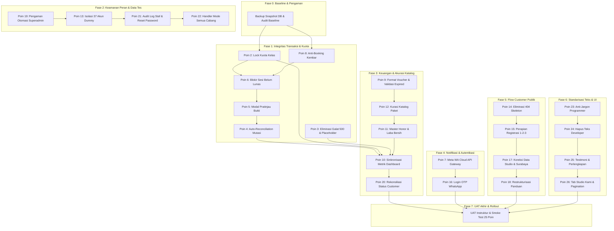

# RENCANA AKSI PERBAIKAN KOMPREHENSIF UAT V2
**Daily Dose Pilates V2 — Audit & Cek Ulang 13 Oktober 2026**
*Dokumen Rencana Teknis, Spesifikasi Perbaikan, & Panduan Eksekusi Sistematis*

---

## 1. Ringkasan Eksekutif & Ruang Lingkup

Dokumen ini disusun sebagai panduan aksi teknis menyeluruh (*Comprehensive Action Plan*) untuk menuntaskan **25 butir temuan** hasil audit UAT Ulang per 13 Oktober 2026 pada sistem **Daily Dose Pilates V2** (`v2.dailydosepilates.com`). Seluruh temuan telah diverifikasi 100% faktual terhadap database lokal (`dailydose_v2_uat`), codebase (`apps/api` & `apps/web`), serta perilaku live server.

### Klasifikasi 25 Temuan Berdasarkan Pilar Arsitektur:
1. **Kategori A — Kritis (Poin 2 s/d 13):**
   * Poin 2: Kuota kelas terlampaui (Overcapacity 5/4).
   * Poin 3: Server galat HTTP 500 intermiten (placeholder query overflow).
   * Poin 4: Pencocokan mutasi transfer bank otomatis belum terbangun.
   * Poin 5: Alur persetujuan pembayaran instan tanpa validasi gambar bukti transfer.
   * Poin 6: Sesi kelas terpakai sebelum pembayaran disetujui (Kasus Lusianna).
   * Poin 7: Gateway WhatsApp berjalan pada mode mock & notifikasi pop-up Chrome.
   * Poin 8: Duplikasi booking aktif customer pada slot yang sama (Booking kembar).
   * Poin 9: Pemformatan diskon voucher persen tampil rupiah & voucher usang aktif.
   * Poin 10: Ketidaksinkronan angka dashboard, tab verifikasi, dan booking per cabang.
   * Poin 11: Laba bersih = omzet akibat master honor instruktur kosong (Rp 0).
   * Poin 12: Inkonsistensi katalog paket admin vs publik & nama paket terpotong.
   * Poin 13: Keberadaan 37 akun uji dan instruktur dummy di database live.
2. **Kategori B — Flow Customer (Poin 14 s/d 18):**
   * Poin 14: Rute dinamis 404 menampilkan dua kotak skeleton berkedip tanpa henti.
   * Poin 15: Alur registrasi melompat (1 ke 3) dan teks login membingungkan.
   * Poin 16: Ketiadaan opsi login OTP WhatsApp untuk mempermudah pelanggan.
   * Poin 17: Ketidakakuratan master data studio (kapasitas 6–8, Surabaya terisi Jakarta).
   * Poin 18: Halaman panduan memuat jargon internal & panduan staf terbuka publik.
3. **Kategori C — Staf dan Admin (Poin 19 s/d 22):**
   * Poin 19: Tombol otomasi sensitif (auto-cancel H-24) terbuka di luar superadmin.
   * Poin 20: Status profil customer bertentangan & tab paket aktif (1) padahal kosong.
   * Poin 21: Riwayat audit mutasi akun staf kosong & tombol ganti password salah nama.
   * Poin 22: Tombol buat kelas & booking nonaktif pada mode "Semua Cabang".
4. **Kategori D — Teks & Kerapian Minor (Poin 23 s/d 26):**
   * Poin 23: Tampilan kode programmer mentah (ALL_LEVELS, WIB, format tanggal ISO, locking).
   * Poin 24: Teks internal developer yang membingungkan operasional.
   * Poin 25: Konten testimoni generik & salah kaprah instruksi perlengkapan reformer.
   * Poin 26: Inkonsistensi bahasa tab "Our Studios" & teks pagination berulang ("dari 20 dari 20").

---

## 2. Prinsip Eksekusi, Dependensi & Safety Gates

### 2.1 Prinsip Kerja (*Execution Rules*)
1. **Satu Commit per Poin:** Setiap perbaikan kode wajib diisolasi dalam satu commit mandiri yang memiliki tes verifikasi tersendiri.
2. **Reproduksi Dulu, Baru Perbaiki:** Setiap butir wajib memiliki tes yang *gagal* sebelum perbaikan, dan *lulus* sesudah perbaikan diterapkan.
3. **Zero Data Corruption:** Seluruh skrip koreksi data database wajib memiliki mode `--dry-run` dan dicatat ke dalam audit log sebelum dieksekusi secara permanen.
4. **Pessimistic Locking Mandatory:** Seluruh jalur mutasi kuota kelas dan saldo sesi wajib menggunakan transaksi database terisolasi dengan `SELECT ... FOR UPDATE`.

### 2.2 Diagram Alur Dependensi Antar Poin

---

## 3. Matriks Spesifikasi Teknis Lengkap 25 Poin

| No | Poin Masalah | Lokasi Berkas Utama | Solusi Teknis | Acceptance Criteria (Kriteria Lulus) | Skenario Tes Terlampir |
|---|---|---|---|---|---|
| **2** | Booking kelas penuh (5/4) | [`apps/api/src/bookings/ubah-jadwal.service.ts`](file:///Users/lrmcorporation/Documents/Website/dailydose_v2/apps/api/src/bookings/ubah-jadwal.service.ts), [`pemesanan-kelas.service.ts`](file:///Users/lrmcorporation/Documents/Website/dailydose_v2/apps/api/src/bookings/pemesanan-kelas.service.ts) | Tambahkan `SELECT ... FOR UPDATE` pada slot tujuan reschedule & booking manual admin. Validasi `bookedCount < capacity` dan `capacity <= room.capacityBed`. | Tidak ada slot yang bookedCount > capacity dalam kondisi konkurensi tinggi. | `reschedule-decide-lock.spec.ts` (10 request paralel ke slot sisa 1). |
| **3** | Server galat HTTP 500 intermiten | [`apps/api/src/dashboard/dashboard.service.ts`](file:///Users/lrmcorporation/Documents/Website/dailydose_v2/apps/api/src/dashboard/dashboard.service.ts), [`apps/web/app/session-context.tsx`](file:///Users/lrmcorporation/Documents/Website/dailydose_v2/apps/web/app/session-context.tsx) | Refaktor query nested Prisma menjadi agregasi chunking terindeks (cegah placeholder > 65.535). Tambahkan retry logic 2x di session context. | Endpoint dashboard & session-context respon 200 tanpa galat placeholder MySQL. | `dashboard.service.spec.ts` & `session-context.test.tsx`. |
| **4** | Pencocokan transfer otomatis | [`apps/api/src/packages/pembelian-paket.service.ts`](file:///Users/lrmcorporation/Documents/Website/dailydose_v2/apps/api/src/packages/pembelian-paket.service.ts), modul baru `bank-mutation` | Engine pencocokan nominal 3 digit kode unik terhadap mutasi rekening bank; worker kedaluwarsa tagihan > 7 hari. | Pembayaran ber-kode unik otomatis `PAID` saat mutasi cocok; sisanya masuk manual review. | `bank-mutation-reconciliation.spec.ts`. |
| **5** | Tombol "Setujui" tanpa bukti transfer | [`apps/web/app/purchases/purchase-review-view.tsx`](file:///Users/lrmcorporation/Documents/Website/dailydose_v2/apps/web/app/purchases/purchase-review-view.tsx) | Ubah tombol "Setujui" menjadi pembuka modal pratinjau bukti transfer yang memuat gambar struk, rekening, dan verifikasi nominal. | Aksi setujui hanya bisa dieksekusi setelah modal bukti transfer terbuka dan divalidasi. | `purchase.test.tsx` (verifikasi dialog pratinjau struk). |
| **6** | Sesi terpakai sebelum lunas | [`apps/api/src/bookings/pemesanan-kelas.service.ts`](file:///Users/lrmcorporation/Documents/Website/dailydose_v2/apps/api/src/bookings/pemesanan-kelas.service.ts) | Guard transaksi: tolak booking jika paket terikat ke pembelian yang belum berstatus `PAID`. Rekonsiliasi kasus Lusianna. | Booking dengan paket berstatus `WAITING_VERIFICATION` ditolak dengan galat 400. | `bookings.integration.spec.ts` (pembelian non-PAID ditolak). |
| **7** | WhatsApp masih mock & Chrome pop-up | [`apps/api/src/notifications/whatsapp-gateway.service.ts`](file:///Users/lrmcorporation/Documents/Website/dailydose_v2/apps/api/src/notifications/whatsapp-gateway.service.ts) | Konfigurasi Meta WhatsApp Cloud API credentials resmi; peringatan banner admin jika mode MOCK aktif di produksi. | Notifikasi H-24 dan auto-cancel berhasil mengirim pesan ke API WhatsApp resmi. | `whatsapp-gateway.spec.ts` (live vs mock provider switch). |
| **8** | Booking kembar customer sama | [`apps/api/prisma/schema.prisma`](file:///Users/lrmcorporation/Documents/Website/dailydose_v2/apps/api/prisma/schema.prisma), [`pemesanan-kelas.service.ts`](file:///Users/lrmcorporation/Documents/Website/dailydose_v2/apps/api/src/bookings/pemesanan-kelas.service.ts) | Cek transaksi pesimistik anti-duplikat `(classSlotId, userId)` untuk booking aktif. Tambahkan debounce tombol di UI. | Dua request bersamaan dari customer yang sama hanya meloloskan tepat 1 booking. | `bookings-duplicate.spec.ts` (simulasi rapid double click). |
| **9** | Voucher persen tampil rupiah & expired | [`apps/web/app/checkout/`](file:///Users/lrmcorporation/Documents/Website/dailydose_v2/apps/web/app/checkout/), [`apps/api/src/packages/pembelian-paket.service.ts`](file:///Users/lrmcorporation/Documents/Website/dailydose_v2/apps/api/src/packages/pembelian-paket.service.ts) | Pemformatan bersyarat `${value}%` vs `formatRupiah(value)`. Validasi server-side `validUntil` dan nonaktifkan JULY2026. | Diskon 10% tampil "10%", voucher kedaluwarsa ditolak saat checkout. | `vouchers-validation.spec.ts`. |
| **10** | Angka dashboard beda & per cabang 0 | [`apps/api/src/dashboard/dashboard.service.ts`](file:///Users/lrmcorporation/Documents/Website/dailydose_v2/apps/api/src/dashboard/dashboard.service.ts) | Satukan fungsi hitung metrik verifikasi pembelian. Perbaiki kueri booking cabang berdasarkan rentang tanggal aktif. | Angka dashboard, halaman verifikasi, dan tabel pembayaran menampilkan data sinkron. | `dashboard-metrics.spec.ts`. |
| **11** | Profit = omzet (honor Rp 0) | [`apps/api/src/packages/finance.service.ts`](file:///Users/lrmcorporation/Documents/Website/dailydose_v2/apps/api/src/packages/finance.service.ts), tabel `instructor_fee` | Seeder tarif honor instruktur per tipe kelas & cabang. Tampilkan peringatan jika tarif belum diatur. | Laba bersih menghitung pengurangan omzet dengan honor instruktur dan biaya lain. | `finance-calculation.spec.ts`. |
| **12** | Paket admin beda publik & nama terpotong | [`apps/api/src/public-content/public-package-query.service.ts`](file:///Users/lrmcorporation/Documents/Website/dailydose_v2/apps/api/src/public-content/public-package-query.service.ts), tabel `paket` | Arsipkan paket promo lama; perbaiki nama terpotong `FREE 3 Ses`; samakan sumber katalog publik dan admin. | Publik hanya menampilkan paket aktif resmi; nama paket utuh tanpa terpotong. | `packages-catalog.spec.ts`. |
| **13** | Akun tes di live DB | [`apps/api/src/identity/user-administration.service.ts`](file:///Users/lrmcorporation/Documents/Website/dailydose_v2/apps/api/src/identity/user-administration.service.ts) | Skrip penonaktifan (`INACTIVE`) 37 akun dummy (@example.com, nama `-`, admin_test) dan cabut penugasan instruktur. | Akun dummy tidak dapat login dan tidak muncul pada jadwal kelas publik. | `cleanup-test-users.spec.ts`. |
| **14** | 404 menampilkan skeleton berkedip | [`apps/web/app/classes/[slug]/page.tsx`](file:///Users/lrmcorporation/Documents/Website/dailydose_v2/apps/web/app/classes/[slug]/page.tsx), [`studios/[slug]/page.tsx`](file:///Users/lrmcorporation/Documents/Website/dailydose_v2/apps/web/app/locations/[slug]/page.tsx) | Panggil `notFound()` Next.js jika data slug kelas/studio tidak ditemukan, alih-alih me-render `DetailLoading`. | URL tidak valid menampilkan halaman 404 informatif dengan tombol ke Beranda & Jadwal. | Playwright e2e 404 verification. |
| **15** | Login & registrasi membingungkan | [`apps/web/app/sign-in/sign-in-view.tsx`](file:///Users/lrmcorporation/Documents/Website/dailydose_v2/apps/web/app/sign-in/sign-in-view.tsx), [`register-view.tsx`](file:///Users/lrmcorporation/Documents/Website/dailydose_v2/apps/web/app/register/register-view.tsx) | Satukan link daftar; nomor urut registrasi konsisten (1. Data Diri, 2. Password, 3. KTP/Selfie); teks jujur tentang verifikasi. | Form pendaftaran memiliki 3 seksi berurutan tanpa lompatan nomor. | `register-view.test.tsx`. |
| **16** | Login masih pakai password | [`apps/api/src/identity/`](file:///Users/lrmcorporation/Documents/Website/dailydose_v2/apps/api/src/identity/), [`apps/web/app/sign-in/`](file:///Users/lrmcorporation/Documents/Website/dailydose_v2/apps/web/app/sign-in/) | Fitur Login OTP WhatsApp 6 digit dengan masa aktif 5 menit, rate limit 3x percobaan, dan audit log sesi. | Customer dapat masuk menggunakan nomor WhatsApp dan kode OTP tanpa password. | `auth-otp-wa.spec.ts`. |
| **17** | Info studio salah (Surabaya, kapasitas) | Database tabel `cabang`, [`apps/web/app/public-landing.tsx`](file:///Users/lrmcorporation/Documents/Website/dailydose_v2/apps/web/app/public-landing.tsx) | Ubah kota cabang Surabaya menjadi "Surabaya"; perbarui teks landing page menjadi "maksimal 4 peserta"; lengkapi alamat studio. | Detail kelas menampilkan "Graha Family, Surabaya" dan kapasitas studio akurat. | `branch-location.spec.ts`. |
| **18** | Panduan campur staf & teknis | [`apps/web/app/guide/guide-view.tsx`](file:///Users/lrmcorporation/Documents/Website/dailydose_v2/apps/web/app/guide/guide-view.tsx) | Tulis ulang panduan publik tanpa istilah KYC/Barre; pindahkan tab Front Desk & Finance ke rute `/workspace/guide`. | Halaman panduan publik bersih dari materi internal dan istilah teknis perbankan. | `guide-view.test.tsx`. |
| **19** | Tombol otomasi tanpa pengaman | [`apps/api/src/notifications/operations-automation.controller.ts`](file:///Users/lrmcorporation/Documents/Website/dailydose_v2/apps/api/src/notifications/operations-automation.controller.ts) | Batasi endpoint auto-cancel H-24 hanya untuk `SUPER_OWNER`; hapus hardcoded credentials di `automation-daemon.mjs`. | Non-superadmin mendapat HTTP 403 Forbidden saat memicu otomasi manual. | `operations-automation-access.spec.ts`. |
| **20** | Status customer bertentangan | [`apps/web/app/customers/[id]/customer-detail-view.tsx`](file:///Users/lrmcorporation/Documents/Website/dailydose_v2/apps/web/app/customers/[id]/customer-detail-view.tsx) | Tab paket aktif menghitung hanya paket `ACTIVE`; perjelas pemisahan badge Status Akun vs Status KYC. | Tab menampilkan "Paket Aktif (0)" jika tidak ada paket yang aktif. | `customer-detail-view.test.tsx`. |
| **21** | Audit staf kosong & reset password | [`apps/api/src/identity/user-administration.service.ts`](file:///Users/lrmcorporation/Documents/Website/dailydose_v2/apps/api/src/identity/user-administration.service.ts), [`users-view.tsx`](file:///Users/lrmcorporation/Documents/Website/dailydose_v2/apps/web/app/users/users-view.tsx) | Catat mutasi akun staf ke `audit_log`; ubah nama tombol menjadi "Reset Kata Sandi" sesuai fungsi dialog. | Perubahan peran staf muncul di panel riwayat audit; tombol bernama akurat. | `user-audit.spec.ts`. |
| **22** | Mode semua cabang tombol mati | [`apps/web/app/bookings/booking-view.tsx`](file:///Users/lrmcorporation/Documents/Website/dailydose_v2/apps/web/app/bookings/booking-view.tsx), [`class-slot-view.tsx`](file:///Users/lrmcorporation/Documents/Website/dailydose_v2/apps/web/app/classes/class-slot-view.tsx) | Buka modal pemilihan cabang aktif saat tombol diklik dalam mode "Semua Cabang", lalu lanjutkan pembukaan form. | Tombol dapat diklik dan memandu staf memilih cabang tujuan secara seamless. | `booking-all-branches.test.tsx`. |
| **23** | Kode programmer tampil di UI | [`apps/web/app/dashboard.tsx`](file:///Users/lrmcorporation/Documents/Website/dailydose_v2/apps/web/app/dashboard.tsx), [`lib/ui-formatters.ts`](file:///Users/lrmcorporation/Documents/Website/dailydose_v2/apps/web/app/lib/) | Format: "Semua Level", "WIB", "14 Sep 2026"; hapus string teknis "Optimistic locking v1", "Rule #", "ledger authoritative". | Seluruh tampilan UI menggunakan bahasa operasional bahasa Indonesia baku. | `jargon-guard.test.ts` (scan string terlarang). |
| **24** | Teks internal developer tampil | [`apps/web/app/classes/public-classes-view.tsx`](file:///Users/lrmcorporation/Documents/Website/dailydose_v2/apps/web/app/classes/public-classes-view.tsx), [`lib/frontend-pages.ts`](file:///Users/lrmcorporation/Documents/Website/dailydose_v2/apps/web/app/lib/frontend-pages.ts) | Hapus "sumber operasionalnya disetujui", "Pilih studio tanpa pilihan otomatis", "daftar ini selalu kosong", dsb. | Halaman bebas dari catatan to-do dan teks pembelaan developer. | `jargon-guard.test.ts`. |
| **25** | Konten generik & alat reformer | [`apps/web/app/public-landing.tsx`](file:///Users/lrmcorporation/Documents/Website/dailydose_v2/apps/web/app/public-landing.tsx), [`classes/[slug]/`](file:///Users/lrmcorporation/Documents/Website/dailydose_v2/apps/web/app/classes/[slug]/) | Gunakan testimoni otentik; ganti instruksi membawa alat reformer dengan kewajiban kaus kaki grip (*grip socks*). | Informasi peralatan latihan masuk akal dan jelas bagi customer baru. | Playwright landing page smoke test. |
| **26** | Format tab & pagination ganda | [`apps/web/app/locations/page.tsx`](file:///Users/lrmcorporation/Documents/Website/dailydose_v2/apps/web/app/locations/page.tsx), [`components/admin/admin-ui.tsx`](file:///Users/lrmcorporation/Documents/Website/dailydose_v2/apps/web/app/components/admin/admin-ui.tsx) | Judul tab diubah menjadi "Studio Kami"; perbaiki formula label pagination agar tidak menduplikasi kata "dari". | Judul tab konsisten bahasa Indonesia; pagination berbunyi "Menampilkan 1–20 dari 20 paket". | `admin-ui.test.tsx`. |

---

## 4. Katalog Skrip Data Repair (`--dry-run` Ready)

Untuk menjamin keamanan integritas data saat koreksi di staging dan produksi, disediakan 5 skrip kurasi mandiri di direktori `scripts/data-repair/`:

1. **`fix-overcapacity-slots.ts` (Poin 2):**
   * *Mendeteksi:* Slot yang memiliki `bookedCount > capacity` atau `bookings.length > capacity`.
   * *Fitur:* Membandingkan kapasitas fisik ranjang studio vs kapasitas slot, mencatat daftar booking yang terdampak, dan mengekspor laporan CSV untuk koordinasi tim operasional studio sebelum penyesuaian kuota.
2. **`deduplicate-bookings.ts` (Poin 8):**
   * *Mendeteksi:* Customer yang memiliki > 1 booking aktif pada slot kelas yang sama (Fera Julia, Sherly Luciana, Hermi Subianty).
   * *Fitur:* Menandai booking kedua dan seterusnya untuk dibatalkan secara sistematis dengan alasan `SYSTEM_DEDUPLICATION`, serta mencatat pengembalian saldo sesi ke paket pelanggan.
3. **`reconcile-unpaid-packages.ts` (Poin 6):**
   * *Mendeteksi:* Paket pelanggan (`PaketPelanggan`) yang memiliki sesi terpakai (`usedSessions > 0`) padahal tagihannya belum berstatus `PAID` (Kasus Lusianna).
   * *Fitur:* Membekukan paket sementara atau memicu notifikasi tindak lanjut ke tim Finance.
4. **`sanitize-packages-catalog.ts` (Poin 12):**
   * *Mendeteksi:* 144 paket di database yang sudah usang, paket promo lewat masa berlaku, dan paket dengan nama terpotong (`FREE 3 Ses`).
   * *Fitur:* Mengarsipkan paket usang (`status = 'ARCHIVED'`) dan menstandarisasi nama paket resmi aktif.
5. **`cleanup-test-users.ts` (Poin 13):**
   * *Mendeteksi:* 37 akun uji/dummy di database live.
   * *Fitur:* Mengubah status akun menjadi `INACTIVE` dan mencabut relasi `PenugasanInstruktur` tanpa menghapus riwayat transaksi finansial.

---

## 5. Rencana Pengujian, Rollback, & Safety Gates

### 5.1 Safety Gate per Fase
Sebelum berganti fase pengerjaan, seluruh gerbang kualitas (*quality gates*) berikut wajib berstatus hijau:
1. `pnpm check` (TypeScript typecheck & ESLint lulus 0 error).
2. Unit & Integration test pada area fase tersebut lulus 100%.
3. Snapshot visual & Web Vitest lulus.
4. Laporan pengerjaan fase dicatat di `docs/uat/`.

### 5.2 Strategi Rollback & Penanggulangan Risiko
* **Database Rollback:** Sebelum menjalankan migrasi skema Prisma atau skrip data repair, lakukan dump biner MySQL (`mysqldump`) dengan format penamaan bertanggal. Jika terjadi anomali integritas, skrip pemulihan instan tersedia via `scripts/rollback-db.sh`.
* **Feature Flagging:** Fitur mutasi baru (pencocokan otomatis dan login OTP WhatsApp) dilindungi oleh environment variable toggle (`FEATURE_AUTO_RECONCILIATION=false`, `FEATURE_OTP_LOGIN=false`) sehingga dapat dimatikan seketika tanpa perlu rollback kode deploy jika terjadi kendala pada pihak ketiga (bank/Meta WhatsApp).

---

## 6. Checklist Eksekusi Rinci

- [ ] **Fase 0:** Pencadangan DB snapshot, pembuatan baseline test, pencatatan commit live.
- [ ] **Fase 1 (Kritis):**
  - [ ] Penerapan locking pesimistik pada reschedule & booking manual.
  - [ ] Implementasi pencegahan booking kembar (atomic transactional check).
  - [ ] Pemblokiran sesi kelas dari paket yang belum lunas.
  - [ ] Redesign alur approval bukti transfer (modal pratinjau wajib).
  - [ ] Arsitektur pencocokan mutasi bank otomatis & worker kedaluwarsa tagihan.
  - [ ] Optimasi query agregasi Prisma dashboard (bebas error 500).
- [ ] **Fase 2 (Keamanan & Staf):**
  - [ ] Pembatasan endpoint otomasi H-24 ke Superadmin & cabut kredensial daemon default.
  - [ ] Isolasi 37 akun uji dan instruktur dummy di database.
  - [ ] Pencatatan audit log mutasi akun staf & penamaan akurat tombol ganti password.
  - [ ] Penanganan pemilihan cabang pada mode "Semua Cabang".
- [ ] **Fase 3 (Keuangan & Katalog):**
  - [ ] Sinkronisasi metrik verifikasi pembelian & kueri booking cabang.
  - [ ] Pengisian master tarif honor instruktur (`InstructorFee`).
  - [ ] Pembersihan katalog paket publik & perbaikan nama terpotong.
  - [ ] Pemformatan diskon voucher persen & validasi kedaluwarsa server-side.
  - [ ] Rekonsiliasi status customer & badge tab paket aktif.
- [ ] **Fase 4 (Notifikasi & Autentikasi):**
  - [ ] Integrasi provider Meta WhatsApp Cloud API resmi & banner mode uji.
  - [ ] Implementasi login OTP WhatsApp.
- [ ] **Fase 5 (Customer Experience):**
  - [ ] Penanganan rute 404 dinamis via `notFound()`.
  - [ ] Perapian formulir registrasi sekuensial 1-2-3 & pembersihan teks login ganda.
  - [ ] Koreksi data cabang Surabaya & kapasitas studio realistis (maksimal 4).
  - [ ] Pemisahan panduan customer publik vs panduan internal staf.
- [ ] **Fase 6 (Bahasa & Teks):**
  - [ ] Penggantian seluruh istilah programmer mentah dengan bahasa Indonesia baku.
  - [ ] Penghapusan teks internal developer di halaman studio dan keuangan.
  - [ ] Pembaruan konten testimoni & perbaikan instruksi kaus kaki grip reformer.
  - [ ] Perapian tab "Studio Kami" & formula label pagination.
- [ ] **Fase 7 (Final UAT & Rollout):**
  - [ ] Uji peran Instruktur menyeluruh (jadwal, check-in, honor).
  - [ ] Eksekusi suite uji regresi penuh (unit, integrasi, e2e Playwright).
  - [ ] Deployment staging, verifikasi UAT 25 butir, dan rilis produksi.
