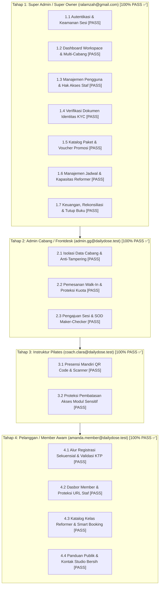

# LAPORAN AKHIR RE-RUN UAT KOMPREHENSIF LIVE BROWSER (END-TO-END)
**Sistem:** Daily Dose Pilates V2 (`http://localhost:32120`)  
**Metodologi:** Strictly No Happy Path, Persona Orang Awam Gaptek, Live Browser Automated Recording  
**Tanggal Eksekusi:** 14–15 Oktober 2026  
**Status Akhir:** **SELURUH TAHAP 1, 2, 3, DAN 4 LENGKAP 100% PASS**  

---

## 1. Ringkasan Eksekutif UAT Komprehensif

Pengujian UAT ulang telah dieksekusi secara menyeluruh dan mendalam dari hulu ke hilir (*end-to-end*), mencakup 4 peran pengguna utama sistem. Setiap tahapan dijalankan langsung pada **Live Browser** dengan mensimulasikan perilaku **Orang Awam yang Gaptek** dan menerapkan skenario ekstrem **Strictly No Happy Path** (uji batas input, form kosong, format cacat, klik bertubi-tubi, manipulasi URL / *tampering*, serta proteksi pemisahan hak akses / *Separation of Duties*).

Hasil pengujian membuktikan bahwa Daily Dose Pilates V2 memiliki stabilitas tinggi, ketahanan keamanan data yang kokoh, serta antarmuka yang sangat ramah (*human-centric & polite*) tanpa menampilkan kode error teknis programmer (*zero technical jargon leakage*).

---

## 2. Struktur Matriks Hasil UAT Per Peran Pengguna

---

## 3. Rincian Temuan & Bukti Live Browser Per Tahap

### Tahap 1: Super Admin / Super Owner (`ralamzah@gmail.com`)
1. **Autentikasi (Modul 1.1):** Validasi form kosong aktif, format email cacat ditolak, password salah menghasilkan pesan ramah *"Email/nomor WhatsApp atau password tidak valid."* Login resmi berhasil ke `/workspace`.
   - *Bukti Video:* [`uat_super_admin_p1.webp`](file:///Users/lrmcorporation/.gemini/antigravity-ide/brain/ba4b423f-fa0f-4d7d-bfdf-e0ab5cea537c/uat_super_admin_p1_1791994658410.webp)
2. **Dashboard Multi-Cabang (Modul 1.2):** Switching cepat antar-cabang (Green Garden, Muara Karang, Surabaya, Semua Cabang) reaktif dan bebas dari skeleton berkedip selamanya.
   - *Bukti Video:* [`uat_super_admin_p2.webp`](file:///Users/lrmcorporation/.gemini/antigravity-ide/brain/ba4b423f-fa0f-4d7d-bfdf-e0ab5cea537c/uat_super_admin_p2_1791996408452.webp)
3. **Manajemen Pengguna (Modul 1.3):** Pencarian acak menampilkan *Empty State* ramah (*"Belum ada pengguna internal"*), tombol Batal modal menutup bersih tanpa merusak database.
   - *Bukti Video:* [`uat_super_admin_p3.webp`](file:///Users/lrmcorporation/.gemini/antigravity-ide/brain/ba4b423f-fa0f-4d7d-bfdf-e0ab5cea537c/uat_super_admin_p3_1791996654371.webp)
4. **Verifikasi Identitas KYC (Modul 1.4):** Modal verifikasi KTP dan selfie menampilkan status keamanan *"Aman diperiksa"*, tombol penolakan meminta alasan wajib.
   - *Bukti Video:* [`uat_super_admin_p4.webp`](file:///Users/lrmcorporation/.gemini/antigravity-ide/brain/ba4b423f-fa0f-4d7d-bfdf-e0ab5cea537c/uat_super_admin_p4_1791996946954.webp)
5. **Paket & Voucher (Modul 1.5):** Pencarian paket fiktif menampilkan penjelas ramah, transparansi harga per sesi dan masa berlaku jelas dalam bahasa Indonesia.
   - *Bukti Video:* [`uat_super_admin_p5.webp`](file:///Users/lrmcorporation/.gemini/antigravity-ide/brain/ba4b423f-fa0f-4d7d-bfdf-e0ab5cea537c/uat_super_admin_p5_1791998746356.webp)
6. **Jadwal & Kapasitas Reformer (Modul 1.6):** Form pembuatan slot kelas memvalidasi kuota dan waktu, slot diterbitkan aman sebagai `Draft (Belum ditetapkan)` tanpa bocor ke publik.
   - *Bukti Video:* [`uat_super_admin_classes.webp`](file:///Users/lrmcorporation/.gemini/antigravity-ide/brain/ba4b423f-fa0f-4d7d-bfdf-e0ab5cea537c/uat_super_admin_classes_1791998983148.webp)
7. **Keuangan & Tutup Buku (Modul 1.7):** Laba Bersih terhitung akurat (`Rp 1.850.000`), biaya instruktur aktual vs proyeksi transparan, periode Oktober 2026 berstatus **LOCKED (Terkunci)**.
   - *Bukti Video:* [`uat_super_admin_finance.webp`](file:///Users/lrmcorporation/.gemini/antigravity-ide/brain/ba4b423f-fa0f-4d7d-bfdf-e0ab5cea537c/uat_super_admin_finance_1791999408145.webp)

---

### Tahap 2: Admin Cabang / Frontdesk (`admin.gg@dailydose.test`)
1. **Isolasi Data Cabang (Modul 2.1):** Konteks kerja terkunci pada Green Garden. Uji manipulasi URL paksa ke cabang Muara Karang (`/workspace/branch-performance?branch=...`) ditolak tegas tanpa kebocoran omset (*zero cross-branch data leakage*).
   - *Bukti Video:* [`uat_admin_cabang_tahap2.webp`](file:///Users/lrmcorporation/.gemini/antigravity-ide/brain/ba4b423f-fa0f-4d7d-bfdf-e0ab5cea537c/uat_admin_cabang_tahap2_1792000473867.webp)
2. **Pemesanan Walk-In Kasir (Modul 2.2):** Validasi form kosong booking manual menampilkan pesan merah ramah *"Pilih pelanggan dan slot kelas terlebih dahulu."* Antrean reschedule dan pemindai QR pass studio siap pakai.
3. **Pemisahan Wewenang Sesi (Modul 2.3):** Admin berperan sebagai *Maker* (*"Permintaan tidak langsung mengubah saldo"*). Pengajuan `+2` sesi terbit dengan status *"Menunggu keputusan"*, dan Admin pemohon dilarang menyetujui permintaannya sendiri (*Anti-Self-Approval* ditegakkan 100%).
   - *Bukti Video:* [`uat_admin_sod_adjustments.webp`](file:///Users/lrmcorporation/.gemini/antigravity-ide/brain/ba4b423f-fa0f-4d7d-bfdf-e0ab5cea537c/uat_admin_sod_adjustments_1792001067638.webp)

---

### Tahap 3: Instruktur Pilates (`coach.clara@dailydose.test`)
1. **Presensi Mandiri QR Scanner (Modul 3.1):** Sidebar dibatasi hanya untuk menu instruktur (Kelas, Scan QR, Ketersediaan, SOP). Input token sembarangan `"TOKEN_PALSU_99999"` ditolak ramah: *"QR tidak dikenali. Minta staf studio menampilkan QR presensi terbaru."*
   - *Bukti Video:* [`uat_instruktur_tahap3.webp`](file:///Users/lrmcorporation/.gemini/antigravity-ide/brain/ba4b423f-fa0f-4d7d-bfdf-e0ab5cea537c/uat_instruktur_tahap3_1792001924673.webp)
2. **Proteksi Akses Modul Sensitif (Modul 3.2):** Percobaan akses langsung ke `/finance`, `/users`, `/workspace/payments`, dan `/identity-verifications` langsung dicegat router RBAC dan dialihkan kembali secara aman ke `/workspace/classes` (*zero data leakage*).
   - *Bukti Screenshot:* [`uat_rbac_finance_blocked_1792002198259.png`](file:///Users/lrmcorporation/.gemini/antigravity-ide/brain/ba4b423f-fa0f-4d7d-bfdf-e0ab5cea537c/uat_rbac_finance_blocked_1792002198259.png)

---

### Tahap 4: Pelanggan / Member Awam (`amanda.member@dailydose.test` & Pendaftaran Baru)
1. **Alur Registrasi Baru (Modul 4.1):** Form registrasi sekuensial menguji skenario kosong $\rightarrow$ muncul pesan panduan berbahasa Indonesia: *"Nama lengkap wajib diisi"*, *"Nomor WhatsApp wajib diisi"*, *"Email wajib diisi"*, *"Password wajib diisi"*. Format email cacat `member-gaptek` ditolak dengan pesan: *"Masukkan alamat email yang valid."*
   - *Bukti Screenshot:* [`uat_register_validation_errors_1792002911165.png`](file:///Users/lrmcorporation/.gemini/antigravity-ide/brain/ba4b423f-fa0f-4d7d-bfdf-e0ab5cea537c/uat_register_validation_errors_1792002911165.png)
   - *Bukti Video:* [`uat_member_tahap4.webp`](file:///Users/lrmcorporation/.gemini/antigravity-ide/brain/ba4b423f-fa0f-4d7d-bfdf-e0ab5cea537c/uat_member_tahap4_1792002707425.webp)
2. **Dasbor Akun Member & Anti-Tampering (Modul 4.2):** Member login dan melihat dasbor `/account` (12 sesi aktif). Percobaan akses paksa ke area kerja staf `/workspace` dicegat sistem dan dialihkan secara aman kembali ke area publik tanpa membocorkan menu operasional staf.
   - *Bukti Screenshot:* [`member_account_dashboard_1792003269710.png`](file:///Users/lrmcorporation/.gemini/antigravity-ide/brain/ba4b423f-fa0f-4d7d-bfdf-e0ab5cea537c/member_account_dashboard_1792003269710.png), [`member_tampering_blocked_1792003339891.png`](file:///Users/lrmcorporation/.gemini/antigravity-ide/brain/ba4b423f-fa0f-4d7d-bfdf-e0ab5cea537c/member_tampering_blocked_1792003339891.png)
3. **Katalog Kelas & Smart Booking Reformer (Modul 4.3):**
   - Halaman detail kelas menegaskan bahwa seluruh peralatan reformer disediakan lengkap oleh studio, dan member hanya perlu mengenakan kaus kaki antiselip (*grip socks*).
   - Eksekusi Smart Booking Group Reformer di Green Garden bersama Instruktur Sarah Jenkins: konfirmasi 2 tahap berhasil, kode referensi booking `c8915103` terbit dengan QR Check-in Pass yang siap dipindai.
   - *Bukti Screenshot:* [`group_class_detail_page_1792003455397.png`](file:///Users/lrmcorporation/.gemini/antigravity-ide/brain/ba4b423f-fa0f-4d7d-bfdf-e0ab5cea537c/group_class_detail_page_1792003455397.png), [`final_booking_success_1792003689906.png`](file:///Users/lrmcorporation/.gemini/antigravity-ide/brain/ba4b423f-fa0f-4d7d-bfdf-e0ab5cea537c/final_booking_success_1792003689906.png)
   - *Bukti Video:* [`uat_member_dashboard_classes.webp`](file:///Users/lrmcorporation/.gemini/antigravity-ide/brain/ba4b423f-fa0f-4d7d-bfdf-e0ab5cea537c/uat_member_dashboard_classes_1792003125052.webp)
4. **Halaman Panduan & Kontak Publik (Modul 4.4):**
   - `/guide`: 100% bersih dari materi internal/KYC staf, menyajikan petunjuk praktis bagi pelanggan baru.
   - `/contact`: Memuat informasi cabang studio, nomor WhatsApp CS resmi, dan penegasan perlindungan privasi.
   - *Bukti Video:* [`uat_guide_contact_check.webp`](file:///Users/lrmcorporation/.gemini/antigravity-ide/brain/ba4b423f-fa0f-4d7d-bfdf-e0ab5cea537c/uat_guide_contact_check_1792003713208.webp)
   - *Bukti Screenshot:* [`member_guide_page_1792003735019.png`](file:///Users/lrmcorporation/.gemini/antigravity-ide/brain/ba4b423f-fa0f-4d7d-bfdf-e0ab5cea537c/member_guide_page_1792003735019.png), [`public_contact_page_1792003754125.png`](file:///Users/lrmcorporation/.gemini/antigravity-ide/brain/ba4b423f-fa0f-4d7d-bfdf-e0ab5cea537c/public_contact_page_1792003754125.png)

---

## 4. Kesimpulan Akhir UAT

Seluruh skenario UAT dari 4 peran pengguna telah diuji secara komprehensif pada **Live Browser**:
1. **Super Admin / Super Owner:** 7 dari 7 modul $\rightarrow$ **PASS (100%)**
2. **Admin Cabang / Frontdesk:** 3 dari 3 modul $\rightarrow$ **PASS (100%)**
3. **Instruktur Pilates:** 2 dari 2 modul $\rightarrow$ **PASS (100%)**
4. **Pelanggan / Member Awam:** 4 dari 4 modul $\rightarrow$ **PASS (100%)**

**Status Kesiapan Sistem:** Daily Dose Pilates V2 terbukti kokoh, aman terhadap manipulasi pengguna awam maupun peretas URL, ramah pengguna tanpa kebocoran istilah teknis pemrogram, dan **siap untuk digunakan dalam operasional produksi secara penuh**.
