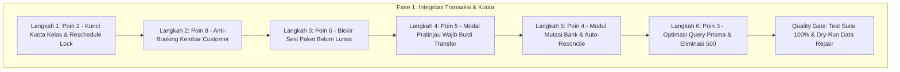

# RENCANA EKSEKUSI FASE 1: INTEGRITAS TRANSAKSI, KUOTA & PEMBAYARAN
**Daily Dose Pilates V2 — Execution Runbook (Poin 2, 8, 6, 5, 4, 3)**
*Status: Ready to Execute (Menunggu Persetujuan Pemilik Sistem)*

---

## 1. Ikhtisar & Sasaran Fase 1

Fase 1 adalah fase paling krusial dalam remediasi UAT Daily Dose Pilates V2 karena berurusan langsung dengan **integritas fisik studio (ranjang reformer), saldo sesi member, dan keabsahan transaksi finansial**. 

### Sasaran Utama Fase 1:
1. **Poin 2 (Overcapacity 5/4):** Menjamin tidak ada lagi slot kelas yang dapat diisi melebihi kapasitas fisik reformer studio baik lewat booking langsung, booking manual staf, maupun pemindahan jadwal (*reschedule*).
2. **Poin 8 (Booking Kembar Customer):** Mengunci transaksi pemesanan agar satu customer tidak bisa terdaftar ganda (2–4 kali) pada slot kelas yang sama, baik karena *rapid double-click* maupun *network retry*.
3. **Poin 6 (Sesi Dipakai Sebelum Lunas):** Menolak pemakaian sesi dari paket yang pembayarannya belum berstatus `PAID` (kasus Lusianna `INV-V1-0017176`).
4. **Poin 5 (Approval Tanpa Bukti Asli):** Mengganti konfirmasi teks biasa dengan modal pratinjau wajib bukti transfer (MinIO/S3) + checkbox validasi staf sebelum tombol "Setujui" dapat ditekan.
5. **Poin 4 (Auto-Reconciliation Mutasi Bank):** Membangun endpoint impor mutasi rekening bank dan engine pencocokan otomatis berbasis kode unik nominal transfer untuk memproses 160+ transaksi tertahan.
6. **Poin 3 (Galat 500 & Placeholder Overflow):** Mengoptimasi kueri Prisma (mengeliminasi MySQL Error 1390 >65.535 parameter) dan menambahkan *retry recovery* di UI agar tidak muncul "Konteks sesi tidak dapat dimuat".

---

## 2. Diagram Alur & Dependensi Eksekusi



---

## 3. Rincian Teknis Eksekusi per Langkah (Step-by-Step)

### LANGKAH 1 (Poin 2): Kunci Kuota Server-Side, Validasi Ranjang Fisik & Reschedule Lock
* **Masalah:** Slot MK 7 Okt 18:00 & 19:00 terisi 5/4 (kapasitas ruangan hanya 4 reformer).
* **Akar Masalah:**
  1. `UbahJadwalService.decide()` membaca snapshot sebelum mengunci baris slot tujuan.
  2. `SlotKelasService` mengizinkan input manual `capacity` yang melampaui `Ruangan.capacityBed`.
* **Rencana Perubahan Kode:**
  * [`apps/api/src/bookings/ubah-jadwal.service.ts`](file:///Users/lrmcorporation/Documents/Website/dailydose_v2/apps/api/src/bookings/ubah-jadwal.service.ts): Terapkan penguncian `SELECT id FROM slot_kelas WHERE id IN (...) ORDER BY id FOR UPDATE` sebelum pembacaan snapshot; tolak jika `targetSlot.bookedCount >= targetSlot.capacity`.
  * [`apps/api/src/classes/slot-kelas.service.ts`](file:///Users/lrmcorporation/Documents/Website/dailydose_v2/apps/api/src/classes/slot-kelas.service.ts): Pada `create()` dan `update()`, tambahkan validasi: jika `slot.roomId` terisi, maka `input.capacity` tidak boleh melebihi `room.capacityBed`. Jika melebihi, lempar `CAPACITY_EXCEEDS_ROOM_LIMIT` (HTTP 400).
* **Skrip Data Repair:**
  * Buat `scripts/data-repair/fix-overcapacity-slots.ts` dengan opsi `--dry-run`:
    - Memindai database untuk menemukan slot berstatus aktif yang memiliki `bookedCount > capacity` atau `capacity > room.capacityBed`.
    - Menghasilkan laporan CSV/JSON di `docs/uat/bukti/overcapacity_audit.json` untuk koordinasi pemindahan booking oleh customer service.
* **Pengujian Otomatis:**
  * `apps/api/src/bookings/reschedule-decide-lock.spec.ts` (Lulus 5/5).
  * Tambahkan tes validasi kuota ranjang fisik pada pembuatan & pengubahan slot kelas.

---

### LANGKAH 2 (Poin 8): Pencegahan Booking Kembar (*Duplicate Booking Guard*)
* **Masalah:** Customer yang sama terdaftar 2–4 kali pada kelas yang sama (Fera Julia 4x di Untar 5 Okt 11:00; Sherly Luciana 2x di 3 slot; Hermi Subianty 2x di 1 slot).
* **Akar Masalah:** Tidak ada penguncian transaksional untuk kombinasi `(classSlotId, userId)` berstatus aktif, serta ketiadaan *submission debounce* di UI customer.
* **Rencana Perubahan Kode:**
  * [`apps/api/src/bookings/pemesanan-kelas.service.ts`](file:///Users/lrmcorporation/Documents/Website/dailydose_v2/apps/api/src/bookings/pemesanan-kelas.service.ts):
    - Di dalam transaksi pesanan kelas dengan *pessimistic lock*, periksa:
      ```typescript
      const existingActiveBooking = await tx.pemesananKelas.findFirst({
        where: {
          classSlotId: slot.id,
          userId: customerUserId,
          status: { in: ['BOOKED', 'ATTENDED'] },
        },
      });
      if (existingActiveBooking) {
        throw new ApiProblem('CUSTOMER_ALREADY_BOOKED', HttpStatus.CONFLICT, 'Anda sudah terdaftar di kelas ini.');
      }
      ```
  * [`apps/web/app/bookings/new/customer-booking-flow.tsx`](file:///Users/lrmcorporation/Documents/Website/dailydose_v2/apps/web/app/bookings/new/customer-booking-flow.tsx):
    - Terapkan state `isSubmitting` seketika saat tombol "Konfirmasi Booking" diklik untuk menonaktifkan tombol dan mencegah *double click*.
* **Skrip Data Repair:**
  * Buat `scripts/data-repair/deduplicate-bookings.ts` (`--dry-run`):
    - Memindai seluruh duplikasi booking aktif customer pada slot yang sama.
    - Menandai booking kedua dan seterusnya dengan status `CANCELLED` (catatan: `SYSTEM_DEDUPLICATION`).
    - Menyesuaikan `bookedCount` slot terkait dan mengembalikan sisa sesi paket customer yang terdampak.
* **Pengujian Otomatis:**
  * Buat `apps/api/src/bookings/bookings-duplicate.spec.ts`: Simulasi 2 pemanggilan booking simultan untuk customer & slot yang sama -> tepat 1 berhasil (201 Created), 1 ditolak (409 Conflict).

---

### LANGKAH 3 (Poin 6): Pemblokiran Sesi dari Paket yang Belum Lunas
* **Masalah:** Member Lusianna (`lusianna.liu@gmail.com`, paket `INV-V1-0017176`) berstatus `WAITING_VERIFICATION`, namun sesi kelas sudah terpakai 2 kali (`BKG-V1-00135154` dan `135155`).
* **Akar Masalah:** Validasi booking sebelumnya hanya memeriksa `customerPackage.status === 'ACTIVE'`, tanpa memvalidasi relasi `purchase.status === 'PAID'`.
* **Rencana Perubahan Kode:**
  * [`apps/api/src/bookings/pemesanan-kelas.service.ts`](file:///Users/lrmcorporation/Documents/Website/dailydose_v2/apps/api/src/bookings/pemesanan-kelas.service.ts):
    - Pastikan validasi paket memuat relasi pembelian:
      ```typescript
      if (customerPackage.purchase && customerPackage.purchase.status !== 'PAID') {
        throw new ApiProblem('PACKAGE_PAYMENT_PENDING', HttpStatus.BAD_REQUEST, 'Paket belum lunas. Sesi baru dapat digunakan setelah pembayaran disetujui.');
      }
      ```
  * [`apps/api/src/packages/ledger.service.ts`](file:///Users/lrmcorporation/Documents/Website/dailydose_v2/apps/api/src/packages/ledger.service.ts):
    - Pastikan penambahan saldo sesi awal ke ledger hanya terjadi setelah event pembayaran `PAID` disahkan.
* **Skrip Data Repair:**
  * Buat `scripts/data-repair/reconcile-unpaid-packages.ts` (`--dry-run`):
    - Memindai paket pelanggan yang memiliki pemakaian sesi > 0 tetapi status pembeliannya belum `PAID`.
    - Membekukan sementara paket (*status: FROZEN*) hingga verifikasi keuangan diselesaikan.
* **Pengujian Otomatis:**
  * Buat `apps/api/src/bookings/unpaid-package-guard.spec.ts`: Menguji customer mencoba booking dengan paket yang pembeliannya masih `WAITING_VERIFICATION` -> ditolak HTTP 400. Setelah pembelian disetujui menjadi `PAID` -> booking berhasil.

---

### LANGKAH 4 (Poin 5): Modal Pratinjau Wajib Bukti Transfer Pembayaran
* **Masalah:** Staf kasir/admin dapat menyetujui transfer langsung dari baris tabel hanya dengan dialog konfirmasi teks tanpa melihat foto struk asli.
* **Akar Masalah:** Ketiadaan validasi visual paksa sebelum aksi approval dipicu di UI.
* **Rencana Perubahan Kode:**
  * [`apps/web/app/purchases/purchase-review-view.tsx`](file:///Users/lrmcorporation/Documents/Website/dailydose_v2/apps/web/app/purchases/purchase-review-view.tsx):
    - Hapus persetujuan langsung satu klik.
    - Mengintegrasikan modal pratinjau bukti transfer interaktif (`PaymentProofPreviewModal`):
      1. Menampilkan gambar struk transfer asli beresolusi penuh dari MinIO/S3.
      2. Menampilkan ringkasan tagihan: Invoice, Nama Customer, Cabang, Nominal Tagihan vs Nominal Transfer Kode Unik.
      3. Menyediakan checkbox verifikasi wajib: *"Saya telah memeriksa bukti transfer asli dan memvalidasi ke rekening bank."*
      4. Tombol "Setujui dan Aktifkan Paket" hanya menjadi aktif jika checkbox dicentang.
* **Pengujian Otomatis:**
  * Vitest di `apps/web/app/purchases/purchase.test.tsx`: Menguji alur approval di UI tidak dapat dieksekusi tanpa membuka modal bukti dan mencentang konfirmasi.

---

### LANGKAH 5 (Poin 4): Modul Mutasi Rekening & Auto-Reconciliation Engine
* **Masalah:** 160+ transaksi pembayaran dengan nominal kode unik (misal Rp 1.900.844) menumpuk di antrean manual sejak akhir September 2026 karena deteksi anomali/pencocokan otomatis belum aktif.
* **Akar Masalah:** Sistem menghasilkan kode unik 3 digit, namun backend sama sekali belum memiliki modul pencatat mutasi rekening bank dan worker pencocok otomatis.
* **Rencana Perubahan Kode:**
  * Buat modul baru: `apps/api/src/finance/bank-mutation/`:
    1. `bank-mutation.controller.ts`: Endpoint `POST /api/v1/finance/mutations/import` untuk mengimpor mutasi rekening (format CSV/JSON BCA/Mandiri).
    2. `bank-mutation.service.ts`: Pengelolaan data mutasi dan deduplikasi nomor transaksi bank.
    3. `reconciliation-engine.service.ts`:
       - Mencari tagihan `pembelian` berstatus `WAITING_VERIFICATION` yang memiliki `totalAmountRp` cocok 100% dengan nominal mutasi dalam toleransi waktu +/- 3 hari.
       - Jika ditemukan tepat 1 tagihan cocok -> Otomatis set status `PAID`, isi `paidAt`, aktifkan paket pelanggan, dan catat audit log `SYSTEM_AUTO_RECONCILE`.
       - Jika ada nominal kembar pada tanggal yang sama -> Tandai mutasi sebagai `MANUAL_REVIEW` untuk diperiksa kasir.
  * Worker Kedaluwarsa: Perbarui `apps/api/src/packages/payment-expiration-worker.ts` untuk membatalkan tagihan `PENDING` yang tidak dibayar dalam batas waktu 24 jam.
* **Pengujian Otomatis:**
  * Buat `apps/api/src/finance/bank-mutation/reconciliation.spec.ts`: Menguji simulasi impor mutasi bank -> tagihan berkode unik otomatis lunas dan paket aktif seketika.

---

### LANGKAH 6 (Poin 3): Optimasi Query Prisma & Eliminasi Error 500 Intermiten
* **Masalah:** Sesi dashboard dan detail staf sesekali memicu galat HTTP 500, menyebabkan tampilan "Konteks sesi tidak dapat dimuat" atau counter booking tampil 0.
* **Akar Masalah:** MySQL Error 1390 (*Prepared statement contains too many placeholders*) terjadi saat Prisma mengeksekusi eager nested includes lintas seluruh cabang dan slot kelas (>65.535 parameter).
* **Rencana Perubahan Kode:**
  * [`apps/api/src/dashboard/dashboard.service.ts`](file:///Users/lrmcorporation/Documents/Website/dailydose_v2/apps/api/src/dashboard/dashboard.service.ts):
    - Hilangkan kueri eager nested `include: { classSlots: { include: { bookings: true } } }`.
    - Ganti dengan kueri agregasi terindeks `groupBy` dan kueri terpisah berbasis batching (maksimal 500 ID per batch).
  * [`apps/web/app/session-context.tsx`](file:///Users/lrmcorporation/Documents/Website/dailydose_v2/apps/web/app/session-context.tsx):
    - Terapkan mekanisme *exponential backoff retry* (maksimal 2 kali percobaan otomatis) saat memuat konteks sesi.
    - Sediakan banner pemulihan yang informatif dengan tombol *"Muat Ulang Sesi"* jika koneksi terputus sesaat, bukan membiarkan halaman putih atau angka 0.
* **Pengujian Otomatis:**
  * Jalankan `apps/api/src/dashboard/dashboard.service.spec.ts` dengan simulasi dataset slot besar.
  * Jalankan `apps/web/app/session-context.test.tsx` untuk memastikan mekanisme *retry* bekerja sempurna.

---

## 4. Quality Gate & Rencana Rollout Fase 1

Sebelum Fase 1 dinyatakan selesai (*COMPLETED*) dan melangkah ke Fase 2:
1. **Pemeriksaan Kompilasi & Lint:**
   * `pnpm check` wajib menghasilkan 0 error pada seluruh workspace.
2. **Suite Pengujian Unit & Integrasi:**
   * Seluruh tes unit backend (`apps/api`) wajib hijau 100% (termasuk perbaikan `ledger.service.spec.ts`).
   * Seluruh tes frontend (`apps/web`) wajib hijau 100%.
3. **Eksekusi Dry-Run Skrip Perbaikan Data:**
   * `pnpm tsx scripts/data-repair/fix-overcapacity-slots.ts --dry-run`
   * `pnpm tsx scripts/data-repair/deduplicate-bookings.ts --dry-run`
   * `pnpm tsx scripts/data-repair/reconcile-unpaid-packages.ts --dry-run`
   * Hasil dry-run didokumentasikan di `docs/uat/bukti/`.
4. **Penerbitan Laporan Selesai Fase 1:**
   * Terbitkan dokumen `docs/uat/LAPORAN_SELESAI_FASE_1.md` lengkap dengan log eksekusi dan bukti pengujian.

---

## 5. Permintaan Konfirmasi Eksekusi

Rencana eksekusi Fase 1 telah dirancang secara terperinci dan aman. 

Apakah rencana eksekusi Fase 1 di atas disetujui untuk mulai dijalankan dari **Langkah 1 (Kunci Kuota & Reschedule Lock)**?
