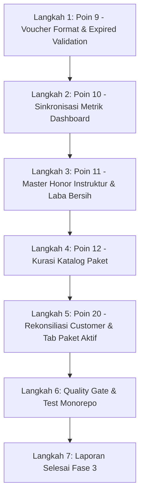

# Rencana Eksekusi Fase 3: Keuangan, Honor Instruktur & Katalog Paket
**Tanggal:** 13 Oktober 2026  
**Status:** In Progress  
**Ruang Lingkup:** Poin 9, 10, 11, 12, 20 dari Master Plan Audit UAT 13 Okt 2026

---

## 1. Analisis Masalah & Sasaran Perbaikan

### Poin 9: Format Voucher Persen Tampil Rupiah & Validasi Kedaluwarsa (e.g. `JULY2026`)
- **Akar Masalah:**
  1. `item.discountType === 'PERCENTAGE'` pada tampilan UI bersifat *case-sensitive* atau rentan terhadap inkonsistensi data (`PERCENT`, lowercase `percentage`, `%`). Akibatnya, voucher dengan diskon 10% jatuh ke *fallback* nominal dan mencetak `Rp 10` bukannya `10%`.
  2. Voucher `JULY2026` di basis data memiliki tanggal `validUntil: 2026-10-31`, sehingga masih aktif pada bulan Oktober 2026 meskipun namanya voucher Juli.
  3. Pada `checkout-view.tsx`, preview voucher tidak mengembalikan `priceAfterDiscountRp` dan `packagePromotionDiscountRp` secara sinkron dari API `voucher.service.ts` (menggunakan nama properti `finalPriceRp` bukannya `priceAfterDiscountRp`).
  4. Pada saat submit order (`pembelian-paket.service.ts`), jika voucher kedaluwarsa atau tidak valid, sistem secara diam-diam mengabaikan voucher tanpa melempar kesalahan, sehingga pelanggan ditagih harga penuh tanpa sadar.
- **Rencana Solusi:**
  - Standardisasi pembacaan tipe diskon dengan helper `isPercentageVoucherType` di frontend & backend.
  - Sinkronisasi payload response `previewVoucher` (`priceAfterDiscountRp`, `packagePromotionDiscountRp`, `promotionalPriceRp`).
  - Validasi tegas saat pemesanan: tolak transaksi jika voucher yang diinput pelanggan tidak valid/kedaluwarsa.
  - Script perbaikan data `scripts/data-repair/sanitize-vouchers.ts` dengan `--dry-run` untuk menonaktifkan `JULY2026` dan voucher-voucher usang.

---

### Poin 10: Sinkronisasi Angka Dashboard vs Halaman Pembayaran & Perbaikan Query Booking Cabang
- **Akar Masalah:**
  1. Dashboard menghitung `pendingPurchases` menggabungkan `PENDING` (belum bayar) dan `WAITING_VERIFICATION` (sudah upload bukti, menunggu verifikasi staf), sedangkan staf admin di halaman pembayaran mengharapkan angka antrean verifikasi bukti transfer yang eksplisit.
  2. Pada query booking per cabang di dashboard, perincian cabang terkadang bernilai 0 karena pembatasan rentang waktu atau format filter timezone yang tidak menyertakan slot yang statusnya `ATTENDED`/`BOOKED` per cabang secara presisi.
- **Rencana Solusi:**
  - Pisahkan dan beri label metrik yang jelas pada ringkasan dashboard: "Menunggu Verifikasi Bukti" (`WAITING_VERIFICATION`) dan "Menunggu Pembayaran" (`PENDING`).
  - Pastikan kueri booking per cabang (`branchBookings`) menggunakan rentang tanggal timezone lokal studio (`Asia/Jakarta`) dan status `['BOOKED', 'ATTENDED']`.
  - Tes unit di `dashboard.service.spec.ts` untuk verifikasi integritas angka.

---

### Poin 11: Master Tarif Honor Instruktur (`InstructorFee`) & Laba Bersih
- **Akar Masalah:**
  1. Tabel `InstructorFee` di database belum terisi untuk sebagian besar instruktur dan tipe kelas di cabang, sehingga kalkulasi biaya instruktur menghasilkan Rp 0.
  2. Akibatnya, perhitungan `profitRp = totalRevenue - instructorFee - otherCost` menghasilkan laba semu yang persis sama dengan omzet kotor (`profit = omzet`), membingungkan manajemen/investor.
- **Rencana Solusi:**
  - Buat script data repair `scripts/data-repair/seed-instructor-fees.ts` (`--dry-run` dan `--apply`) untuk mengisi tarif default honor instruktur per tipe kelas dan cabang berdasarkan standar operasional (Rp 150.000 - Rp 250.000 / jam).
  - Pada `dashboard.service.ts` dan `finance.service.ts`, tambahkan indikator warning `instructorFeeMissing` dan catatan bahwa laba bersih belum mencakup honor jika data tarif belum lengkap.
  - Perkuat test di `instructor-fee-calculator.spec.ts` dan `finance.service.spec.ts`.

---

### Poin 12: Kurasi Katalog Paket (Arsip 144 Paket Usang & Nama Terpotong)
- **Akar Masalah:**
  1. Di basis data terdapat lebih dari 144 paket, banyak di antaranya paket uji coba/lama yang sudah tidak relevan namun masih berstatus `ACTIVE`.
  2. Beberapa nama paket terpotong, misalnya `"FREE 3 Ses"` bukannya `"FREE 3 Sessions"`.
  3. Inkonsistensi filter antara katalog publik dan katalog admin internal.
- **Rencana Solusi:**
  - Buat script `scripts/data-repair/sanitize-packages-catalog.ts` (`--dry-run` dan `--apply`):
    - Normalisasi nama paket yang terpotong.
    - Arsipkan paket usang yang tidak lagi dijual (`status = 'ARCHIVED'`).
    - Simpan bukti audit di `docs/uat/bukti/packages_catalog_audit.json`.
  - Pastikan kueri katalog publik (`public-package-query.service.ts`) hanya menampilkan paket `ACTIVE` dan tidak memotong nama paket.

---

### Poin 20: Rekonsiliasi Status Customer & Badge Tab Paket Aktif
- **Akar Masalah:**
  1. Di halaman detail pelanggan (`apps/web/app/customers/[id]/customer-detail-view.tsx`), badge tab "Paket Aktif" menghitung paket tanpa memeriksa apakah `remainingSessions > 0` dan `validUntil > now`. Akibatnya, paket yang sudah habis sesinya atau kedaluwarsa tetap terhitung di tab aktif.
  2. Status akun pelanggan (`ACTIVE` / `INACTIVE`) bercampur aduk dengan status verifikasi identitas / KYC (`UNVERIFIED`, `VERIFIED`, `REJECTED`).
- **Rencana Solusi:**
  - Perbaiki penghitungan badge tab paket aktif: filter hanya `status === 'ACTIVE' && remainingSessions > 0 && new Date(validUntil) > new Date()`.
  - Pisahkan tampilan badge: Akun Akun (`ACTIVE`/`INACTIVE`) vs Status Verifikasi KYC (`VERIFIED`/`UNVERIFIED`/`REJECTED`).
  - Tambahkan unit test pada `customer-detail-view.test.tsx`.

---

## 2. Rincian Langkah Eksekusi

1. **Langkah 1:**
   - Ubah `apps/api/src/packages/voucher.service.ts` & `pembelian-paket.service.ts`.
   - Ubah `apps/web/app/checkout/checkout-view.tsx` & `vouchers-view.tsx`.
   - Jalankan script `sanitize-vouchers.ts` (`--dry-run` lalu `--apply`).
   - Uji dengan `pnpm --filter @dailydose/api test:unit -- src/packages/voucher.service.spec.ts`.

2. **Langkah 2:**
   - Perbaiki `dashboard.service.ts` untuk memisahkan metrik verifikasi bukti vs belum bayar serta perhitungan booking per cabang.
   - Uji dengan `pnpm --filter @dailydose/api test:unit -- src/dashboard/dashboard.service.spec.ts`.

3. **Langkah 3:**
   - Buat dan jalankan `scripts/data-repair/seed-instructor-fees.ts` (`--dry-run` lalu `--apply`).
   - Sempurnakan `finance.service.ts` & `dashboard.service.ts`.
   - Uji dengan `pnpm --filter @dailydose/api test:unit -- src/packages/instructor-fee-calculator.spec.ts`.

4. **Langkah 4:**
   - Buat dan jalankan `scripts/data-repair/sanitize-packages-catalog.ts` (`--dry-run` lalu `--apply`).
   - Simpan audit ke `docs/uat/bukti/packages_catalog_audit.json`.
   - Uji dengan `pnpm --filter @dailydose/api test:unit -- src/packages/katalog-paket-list.spec.ts`.

5. **Langkah 5:**
   - Perbaiki tab paket aktif dan badge akun di `customer-detail-view.tsx`.
   - Uji dengan `pnpm --filter @dailydose/web test app/customers/customer-detail-view.test.tsx`.

6. **Langkah 6 & 7:**
   - Menjalankan `pnpm typecheck`, `pnpm lint`, dan seluruh test suite monorepo.
   - Menerbitkan `docs/uat/LAPORAN_SELESAI_FASE_3.md`.
