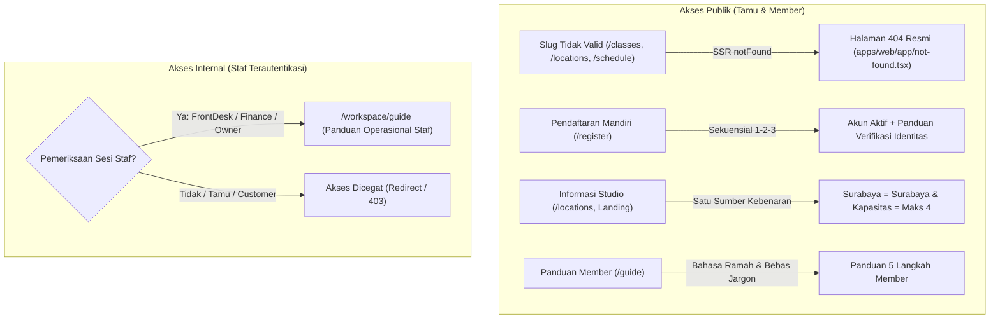

# RENCANA EKSEKUSI FASE 5: PENGALAMAN PELANGGAN PUBLIK (CUSTOMER EXPERIENCE)
**Sistem:** Daily Dose Pilates V2 (`v2.dailydosepilates.com`)  
**Target:** Poin 14, 15, 17, dan 18 dari Dokumen Master Audit UAT 13 Oktober 2026  
**Status:** Siap Dieksekusi (*Ready to Execute*)  
**Metodologi:** Zero Mock Data, Clean Architecture, Strict Access Isolation, Seamless SSR  

---

## 1. Ringkasan Eksekutif & Ruang Lingkup

Fase 5 berfokus pada pembenahan menyeluruh **Alur Pengguna Publik (*Customer Experience & Flow*)**, memastikan setiap titik sentuh pengguna luar (calon member dan member aktif) berjalan intuitif, transparan, bebas dari kedipan rendering (*skeleton flickering*), akurat secara data geografis studio, serta bersih dari keterpaparan dokumen dan instruksi internal operasional.

### 4 Pilar Masalah Fase 5:
1. **Poin 14 — Eliminasi Skeleton Berkedip pada Rute 404 Dinamis:**
   - Menangani slug kelas, studio, dan id jadwal yang tidak valid melalui `notFound()` bawaan Next.js alih-alih me-render `DetailLoading` yang berkedip tanpa henti.
2. **Poin 15 — Standardisasi Alur Registrasi Sekuensial 1-2-3 & Kejujuran Verifikasi:**
   - Menyelaraskan nomor urut formulir pendaftaran: 1. Data Diri, 2. Keamanan Akun, 3. Dokumen Identitas (Opsional).
   - Menegaskan status akun: akun langsung aktif untuk masuk dan melihat katalog, namun pemesanan kelas memerlukan verifikasi identitas (KTP + selfie).
   - Merapikan halaman login (`sign-in-view.tsx`) agar bebas dari tautan ganda dan kebingungan teks.
3. **Poin 17 — Akurasi Data Studio (Cabang Surabaya & Kapasitas Ranjang Fisik):**
   - Menjamin cabang Graha Family Surabaya terdata di kota "Surabaya" (bukan Jakarta) dengan alamat lengkap dan kode pos akurat.
   - Menstandarkan seluruh teks kapasitas kelas studio menjadi "maksimal 4 peserta" (sesuai ranjang fisik reformer) di seluruh halaman publik.
4. **Poin 18 — Restrukturisasi Panduan Publik vs Staf Operasional:**
   - Membersihkan halaman `/guide` publik dari istilah teknis developer dan perbankan (`KYC`, `Barre`, status database mentah).
   - Memindahkan seluruh panduan operasional internal (Front Desk QR Scanner, Finance Mutasi/Approval, Super Owner Command Center) ke rute terproteksi `/workspace/guide`.

---

## 2. Analisis Masalah Mendalam & Solusi Arsitektur



### 2.1 Poin 14: Penanganan Rute Dinamis 404 Tanpa Skeleton Berkedip
- **Akar Masalah:**
  - Halaman SSR `apps/web/app/classes/[slug]/page.tsx`, `apps/web/app/locations/[slug]/page.tsx`, dan `apps/web/app/schedule/[id]/page.tsx` memanggil `publicMetadataValue()` untuk memuat data awal.
  - Saat slug atau ID tidak ditemukan, fungsi mengembalikan `null`, namun halaman tetap merender Client View (`ClassDetailView`, `StudioDetailView`, `ScheduleDetailView`) dengan `initialData={null}`.
  - Komponen client mendeteksi `!item && !failure` lalu merender `DetailLoading` (dua kotak skeleton berdenyut). Client kemudian mencoba memanggil API ulang. Saat API mengembalikan HTTP 404, terjadi kedipan visual (*layout shift & flicker*), dan URL tidak pernah mengembalikan status HTTP 404 resmi ke browser / bot pencari.
- **Solusi Arsitektur:**
  - Pada Server Component: jika `!initialData`, panggil fungsi `notFound()` dari `next/navigation` secara langsung. Next.js akan langsung menghentikan render dan menampilkan `apps/web/app/not-found.tsx` dengan response HTTP 404 yang benar.
  - Pada Client Component: tangani kegagalan fetch client-side jika status adalah 404 dengan memanggil `notFound()` atau me-render tampilan `DetailFailure` yang memiliki tautan balik jelas tanpa skeleton berulang.

### 2.2 Poin 15: Alur Registrasi Sekuensial 1-2-3 & Teks Login Akurat
- **Akar Masalah:**
  - Sebelumnya, formulir registrasi melompat dari seksi 1 ke seksi 3 karena seksi password tidak diberi nomor urut seksi yang konsisten.
  - Teks header mengklaim "akun langsung aktif untuk memesan jadwal", padahal guard transaksi backend menolak pemesanan kelas jika identitas customer belum berstatus diverifikasi (`VERIFIED`). Hal ini memicu kebingungan bagi pengguna baru.
  - Halaman login (`sign-in-view.tsx`) memiliki tombol ganda dan teks yang membingungkan seputar metode login email vs WhatsApp.
- **Solusi Arsitektur:**
  - Standarisasi 3 seksi sekuensial di `apps/web/app/register/register-view.tsx`:
    - **Seksi 1: Data Diri & Kontak** (Nama Lengkap, Nomor WhatsApp aktif dengan normalisasi E.164, Email valid).
    - **Seksi 2: Keamanan Akun** (Kata sandi minimal 8 karakter dan konfirmasi kata sandi dengan toggle intip independen).
    - **Seksi 3: Dokumen Identitas (Opsional — Bisa Nanti)** (Foto KTP dan Selfie dengan pratinjau instan, batas buffer 8 MB, tombol hapus/ganti file).
  - Teks Transparansi: *"Akun Anda langsung aktif setelah mendaftar. Untuk memesan jadwal kelas, lengkapi verifikasi identitas (KTP dan selfie) yang akan ditinjau tim studio."*
  - Halaman login (`sign-in-view.tsx`): Menyatukan pesan bantuan, link pendaftaran tunggal ke `/register`, dan link bantuan WhatsApp resmi `https://wa.me/62895329736127`.

### 2.3 Poin 17: Info Studio Akurat (Cabang Surabaya & Kapasitas Ranjang)
- **Akar Masalah:**
  - Nilai kota cabang Surabaya (`DD-SBY`) pada metadata sempat tercantum sebagai bagian dari wilayah Jakarta, menyebabkan tampilan detail kelas berbunyi *"Graha Family Surabaya, Jakarta"*.
  - Beberapa komponen statis menyebutkan kapasitas studio "6–8 peserta", padahal studio Daily Dose didesain untuk pengalaman pilates privat dan semi-privat dengan kapasitas fisik maksimal 4 peserta per kelas.
- **Solusi Arsitektur:**
  - Pastikan modul otoritatif `apps/api/src/master/branch-location.ts` memetakan seluruh cabang secara tepat:
    - `DD-SBY`: Kota "Surabaya", Area "Dukuhpakis, Surabaya Barat", Alamat "Jl. Taman Perkantoran TP 19-20, Jl. Raya Graha Famili Utara, Pradahkalikendal, Dukuhpakis, Surabaya, Jawa Timur 60277".
    - `DD-GG`: Kota "Jakarta Barat", Area "Kedoya Utara, Kebon Jeruk".
    - `DD-MK`: Kota "Jakarta Utara", Area "Pluit, Penjaringan".
    - `DD-UNTAR`: Kota "Jakarta Barat", Area "Tanjung Duren, Grogol Petamburan".
    - `DD-PIK2`: Kota "Tangerang", Area "PIK 2, Kosambi".
  - Di frontend (`public-landing.tsx`, `hero-carousel.tsx`, `locations-view.tsx`, `studio-detail-view.tsx`), pertegas: *"Intimate Class Size: Maksimal 4 peserta per kelas untuk perhatian instruktur yang maksimal dan postur yang aman."*

### 2.4 Poin 18: Restrukturisasi Panduan Publik vs Staf Operasional
- **Akar Masalah:**
  - Halaman publik `/guide` (`apps/web/app/guide/guide-view.tsx`) menampilkan tab dan konten untuk peran Front Desk, Tim Finance, dan Super Owner jika pengguna tidak dipagari secara ketat.
  - Istilah teknis perbankan dan singkatan pengembang seperti `KYC`, `Barre`, `APPROVED`, `LUNAS` membingungkan pengunjung biasa yang ingin membaca tata cara berlatih pilates.
- **Solusi Arsitektur:**
  - Halaman publik `/guide` (`apps/web/app/guide/page.tsx`):
    - Dikhususkan 100% untuk **Pelanggan / Member**.
    - Memuat 5 alur inti: 1. Pendaftaran & Verifikasi Identitas, 2. Pembelian Paket & Unggah Bukti Transfer, 3. Pemesanan Jadwal Kelas, 4. Kebijakan Ubah Jadwal (Reschedule H-24), 5. Kehadiran di Studio & QR Check-in.
    - 100% bebas dari istilah teknis developer dan singkatan asing yang tidak ramah pengguna.
  - Buat rute internal baru di `/workspace/guide`:
    - File: `apps/web/app/workspace/guide/page.tsx` & `workspace-guide-view.tsx`.
    - Dipagari dengan autentikasi staf (`isStaffSession`). Pelanggan atau pengguna publik yang mengakses rute ini akan dialihkan secara aman ke `/workspace` atau `/guide`.
    - Memuat tata cara operasional: Scanner QR Kehadiran (Front Desk), Rekonsiliasi & Approval Pembayaran (Finance), serta Audit Log & Pemantauan Otomasi (Super Owner).

---

## 3. Matriks Berkas & Perubahan Kode

| Poin | Berkas Sasaran | Tindakan Perubahan | Kriteria Keberhasilan |
| :---: | :--- | :--- | :--- |
| **14** | `apps/web/app/classes/[slug]/page.tsx` | Tambahkan `if (!initialData) notFound();` | Mengakses slug kelas palsu langsung menampilkan halaman 404 tanpa skeleton berkedip. |
| **14** | `apps/web/app/locations/[slug]/page.tsx` | Tambahkan `if (!initialData) notFound();` | Mengakses slug studio palsu langsung me-render 404. |
| **14** | `apps/web/app/schedule/[id]/page.tsx` | Tambahkan `if (!initialData) notFound();` | Mengakses ID jadwal fiktif langsung menampilkan 404. |
| **15** | `apps/web/app/register/register-view.tsx` | Format seksi sekuensial 1-2-3; perjelas edukasi verifikasi identitas; pastikan toggle password lancar. | Pengujian Vitest `register-view.test.tsx` lulus 100% (seksi 1, 2, 3 terurut rapi). |
| **15** | `apps/web/app/sign-in/sign-in-view.tsx` | Bersihkan tautan ganda; pastikan teks login email & WhatsApp jelas; tautan bantuan resmi. | Halaman login bersih, tidak membingungkan member baru. |
| **17** | `apps/web/app/public-landing.tsx`<br>`apps/web/app/components/public/hero-carousel.tsx` | Pertegas teks kapasitas: "Maksimal 4 peserta per sesi reformer". | Tidak ada teks 6–8 peserta yang tertinggal di seluruh antarmuka. |
| **17** | `apps/api/src/master/branch-location.ts`<br>`apps/web/app/locations/locations-view.tsx` | Pastikan cabang Surabaya memetakan ke kota Surabaya dan area Dukuhpakis secara konsisten. | Detail kelas & studio Surabaya menampilkan "Surabaya", bukan "Jakarta". |
| **18** | `apps/web/app/guide/guide-view.tsx` | Kunci halaman publik `/guide` hanya untuk panduan member; hapus teks internal. | Halaman `/guide` bebas dari tab staf dan istilah teknis (KYC, Barre). |
| **18** | `apps/web/app/workspace/guide/page.tsx`<br>`workspace-guide-view.tsx` | Buat halaman panduan staf internal di bawah workspace terproteksi. | Staf dapat membaca SOP operasional di `/workspace/guide` secara aman. |

---

## 4. Langkah-Langkah Eksekusi Bertahap (Task List)

### Langkah 1: Penanganan 404 Dinamis (Poin 14)
1. Perbarui `apps/web/app/classes/[slug]/page.tsx` untuk mengimpor `notFound` dari `next/navigation` dan memanggilnya jika `initialData` bernilai null.
2. Perbarui `apps/web/app/locations/[slug]/page.tsx` untuk memanggil `notFound()` jika data studio null.
3. Perbarui `apps/web/app/schedule/[id]/page.tsx` untuk memanggil `notFound()` jika data jadwal null.
4. Buat tes verifikasi navigasi 404 untuk memastikan bahwa URL dinamis yang tidak terdaftar segera mengembalikan komponen not-found tanpa loop pemuatan skeleton.

### Langkah 2: Penyempurnaan Formulir Registrasi & Teks Login (Poin 15)
1. Periksa `register-view.tsx`: pastikan label seksi terstruktur rapi (1. Data Diri & Kontak, 2. Keamanan Akun, 3. Dokumen Identitas).
2. Periksa teks disclaimer verifikasi agar member memahami bahwa akun mereka aktif namun reservasi jadwal memerlukan verifikasi identitas terlebih dahulu.
3. Jalankan `pnpm --filter @dailydose/web test -- register-view.test.tsx` untuk memastikan kelulusan pengujian unit & a11y.

### Langkah 3: Akurasi Geografis Studio & Kapasitas Ranjang (Poin 17)
1. Verifikasi modul `apps/api/src/master/branch-location.ts` terhadap seluruh cabang di database MySQL riil (`dailydose_v2_uat`).
2. Periksa seluruh komponen teks publik di landing page dan lokasi untuk memastikan informasi kapasitas reformer tertulis "maksimal 4 peserta".
3. Jalankan `pnpm --filter @dailydose/api test:unit -- src/master/branch-location.spec.ts`.

### Langkah 4: Pemisahan Panduan Publik vs Staf Operasional (Poin 18)
1. Refaktor `apps/web/app/guide/guide-view.tsx` agar halaman `/guide` murni hanya menampilkan panduan bagi member/pelanggan.
2. Buat folder dan berkas baru:
   - `apps/web/app/workspace/guide/page.tsx`
   - `apps/web/app/workspace/guide/workspace-guide-view.tsx`
3. Salin dan sesuaikan panduan operasional (Front Desk, Finance, Super Owner) ke dalam `workspace-guide-view.tsx` lengkap dengan guard autentikasi sesi staf.
4. Tambahkan tautan menu "Panduan Operasional" pada navigasi sidebar/workspace jika pengguna adalah staf.
5. Jalankan tes vitest `guide-view.test.tsx` dan pastikan tidak ada kebocoran tab staf di rute publik.

---

## 5. Rencana Pengujian Non-Happy Path & Safety Gates

Sesuai prinsip **Strictly NO HAPPY PATH & NO MOCK DATA**, verifikasi Fase 5 akan menguji skenario kegagalan dan kondisi batas:

1. **Uji 404 Adversarial (Poin 14):**
   - Menembak URL slug berbahaya / acak seperti `/classes/malicious__slug__test_123` dan `/locations/non-existent-branch-999`.
   - **Kondisi Lulus:** Halaman me-render `not-found.tsx` resmi, tidak ada error console tak tertangani, dan tidak ada skeleton gantung.
2. **Uji Validasi Form Registrasi & Password Mismatch (Poin 15):**
   - Mengisi password dan konfirmasi yang tidak sama (`password !== confirmation`).
   - Mengunggah berkas rusak atau melebihi 8 MB.
   - **Kondisi Lulus:** Pesan validasi inline muncul pada elemen input terkait, fokus berpindah ke input pertama yang bermasalah.
3. **Uji Pemindaian Istilah Terlarang & Jargon Internal (Poin 18):**
   - Menjalankan regex scan pada seluruh berkas panduan publik `/guide` terhadap istilah: `KYC`, `Barre`, `APPROVED`, `LUNAS`, `BOOKED`, `ATTENDED`.
   - **Kondisi Lulus:** 0 kemunculan istilah teknis di halaman publik.
4. **Uji Proteksi Akses Panduan Staf (Poin 18):**
   - Mencoba membuka `/workspace/guide` dalam kondisi sesi kosong (tamu) atau sesi customer biasa.
   - **Kondisi Lulus:** Akses dicegat dan dialihkan (*redirect*) ke halaman login atau panduan publik.

---

## 6. Verifikasi & Perintah Eksekusi

Sebelum Fase 5 dinyatakan selesai, perintah-perintah berikut wajib dijalankan dan menghasilkan status hijau:
```bash
# 1. Verifikasi Unit Test Fase 5
pnpm --filter @dailydose/web test -- register-view.test.tsx guide-view.test.tsx locations/public-information-pages.test.tsx
pnpm --filter @dailydose/api test:unit -- src/master/branch-location.spec.ts

# 2. Pemindaian Jargon Terlarang
pnpm --filter @dailydose/web test -- jargon-guard.test.ts

# 3. Typecheck dan Build
pnpm typecheck
```
Laporan pengerjaan formal akan diterbitkan di `docs/uat/LAPORAN_SELESAI_FASE_5.md`.
