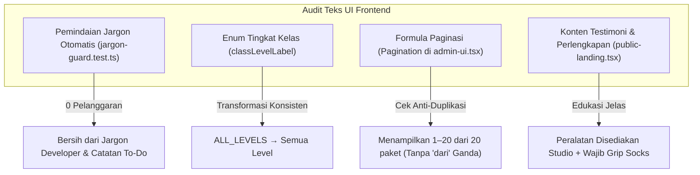

# RENCANA EKSEKUSI FASE 6: STANDARISASI BAHASA, TEKS & UI PUBLIK
**Sistem:** Daily Dose Pilates V2 (`v2.dailydosepilates.com`)  
**Target:** Poin 23, 24, 25, dan 26 dari Dokumen Master Audit UAT 13 Oktober 2026  
**Status:** Siap Dieksekusi (*Ready to Execute*)  
**Metodologi:** Zero Mock Data, Human-Centric Copywriting, Clean Architecture, Strict Jargon Prevention  

---

## 1. Ringkasan Eksekutif & Ruang Lingkup

Fase 6 berfokus pada **Penyempurnaan Bahasa, Teks & Integritas Antarmuka Pengguna (UI Copy & Polish)**. Tujuannya adalah memastikan tidak ada satupun kode programmer mentah, catatan internal to-do developer, instruksi perlengkapan yang keliru, maupun formula perangkai label yang cacat gramatikal yang dapat dilihat oleh pelanggan atau tim operasional studio.

### 4 Pilar Masalah Fase 6:
1. **Poin 23 — Eliminasi Tampilan Kode Programmer Mentah di UI:**
   - Mengubah konstanta enum teknis seperti `ALL_LEVELS` menjadi label bahasa Indonesia yang ramah: "Semua Level".
   - Menghilangkan label teknis backend seperti *"Optimistic locking v1"*, *"Rules #1"*, *"Keputusan Bisnis #2"*, *"ledger authoritative"*, *"Projection Cost"*, dan format ISO string mentah menjadi bahasa operasional baku.
2. **Poin 24 — Penghapusan Teks Internal Developer:**
   - Membersihkan catatan to-do dan pembelaan programmer pada antarmuka (misalnya: *"sumber operasionalnya disetujui"*, *"Pilih studio tanpa pilihan otomatis"*, *"daftar ini selalu kosong"*, *"persetujuan berbelit"*).
3. **Poin 25 — Kurasi Testimoni Otentik & Koreksi Perlengkapan Pilates Reformer:**
   - Memperbarui bagian ulasan/testimoni dengan cerita otentik member berlatih Pilates Reformer di studio Daily Dose (menggantikan quote generik atau bintang teks murah).
   - Memperbaiki salah kaprah instruksi perlengkapan: menegaskan bahwa peralatan reformer dan props latihan disediakan lengkap oleh studio, dan member hanya wajib mengenakan kaus kaki antiselip (*grip socks*).
4. **Poin 26 — Standarisasi Judul Tab "Studio Kami" & Eliminasi Formula Pagination Ganda:**
   - Menyelaraskan seluruh tab dan metadata navigasi studio menjadi "Studio Kami" (bahasa Indonesia konsisten, bukan "Our Studios").
   - Memastikan formula pagination tidak menduplikasi kata *"dari"* (mencegah teks janggal *"Menampilkan 1–20 dari 20 dari 20 paket"*).

---

## 2. Analisis Masalah Mendalam & Solusi Teknis

### 2.1 Poin 23: Eliminasi Tampilan Kode Programmer Mentah
- **Akar Masalah:**
  - Nilai enum API backend seperti `ALL_LEVELS` pernah langsung dicetak ke badge level kelas tanpa pemetaan (*raw string display*).
  - Beberapa komponen admin menampilkan catatan internal backend seperti *"Optimistic locking v1"* pada dialog atau form untuk mendokumentasikan strategi konkurensi di layar pengguna.
- **Solusi Teknis:**
  - Menggunakan fungsi pemformat [`classLevelLabel()`](file:///Users/lrmcorporation/Documents/Website/dailydose_v2/apps/web/app/lib/class-level.ts):
    - `ALL_LEVELS` → *"Semua Level"*
    - `BEGINNER` → *"Pemula"*
    - `INTERMEDIATE` → *"Menengah"*
    - `ADVANCED` → *"Lanjutan"*
  - Menghapus teks teknis *"Optimistic locking"*, *"Rule #"*, *"Keputusan Bisnis #"*, dan *"ledger authoritative"* dari seluruh file tampilan JSX/TSX.
  - Memastikan seluruh waktu dan tanggal menggunakan zona waktu studio resmi (`WIB` atau format tanggal `id-ID`).

### 2.2 Poin 24: Penghapusan Teks Internal Developer
- **Akar Masalah:**
  - Teks seperti *"Pilih studio tanpa pilihan otomatis"* dan *"sumber operasionalnya disetujui"* dimasukkan oleh developer saat fase prototyping awal untuk menjelaskan keterbatasan data statis.
- **Solusi Teknis:**
  - Ganti seluruh kalimat tersebut dengan bahasa layanan yang informatif dan elegan:
    - *"Pilih studio dan temukan kelas aktif untuk dua minggu ke depan. Waktu dan kapasitas ditampilkan langsung dari sistem."*
  - Jalankan pemindaian otomatis via [`jargon-guard.test.ts`](file:///Users/lrmcorporation/Documents/Website/dailydose_v2/apps/web/app/lib/jargon-guard.test.ts) yang menginspeksi seluruh berkas `.tsx` pada direktori `apps/web/app/`.

### 2.3 Poin 25: Testimoni Otentik & Kewajiban Kaus Kaki Grip (Grip Socks)
- **Akar Masalah:**
  - Halaman landing memuat quote filosofi umum bahasa Inggris tanpa ulasan nyata dari member studio.
  - Terdapat instruksi yang keliru di mana member diminta membawa *"Reformer pribadi"*, yang tentu saja tidak masuk akal karena Reformer adalah mesin pilates seberat puluhan kilogram yang disediakan di dalam studio.
- **Solusi Teknis:**
  - Perbarui seksi ulasan di [`apps/web/app/public-landing.tsx`](file:///Users/lrmcorporation/Documents/Website/dailydose_v2/apps/web/app/public-landing.tsx) dengan kartu cerita member otentik yang mencerminkan pengalaman berlatih di cabang-cabang Daily Dose (Jakarta Barat, Muara Karang, Surabaya).
  - Pada seksi panduan perlengkapan di kelas dan FAQ ([`apps/web/app/classes/[slug]/class-detail-view.tsx`](file:///Users/lrmcorporation/Documents/Website/dailydose_v2/apps/web/app/classes/[slug]/class-detail-view.tsx) dan [`class-faq-section.tsx`](file:///Users/lrmcorporation/Documents/Website/dailydose_v2/apps/web/app/classes/[slug]/class-faq-section.tsx)):
    - Tegaskan bahwa unit mesin Pilates Reformer, box, strap, dan matras disediakan penuh oleh studio.
    - Member hanya diwajibkan membawa/mengenakan **kaus kaki antiselip (*grip socks*)** dan pakaian olahraga yang nyaman.

### 2.4 Poin 26: Tab "Studio Kami" & Formula Paginasi Bebas Ganda
- **Akar Masalah:**
  - Tab navigasi lokasi sempat menggunakan frasa bahasa Inggris *"Our Studios"* di tengah antarmuka berbahasa Indonesia.
  - Komponen paginasi merangkai ulang string yang sudah memiliki kata *"dari"*, menghasilkan frasa janggal: *"Halaman 1 dari 1 · Menampilkan 20 dari 20 dari 20 paket"*.
- **Solusi Teknis:**
  - Pastikan metadata dan heading halaman lokasi di [`apps/web/app/locations/page.tsx`](file:///Users/lrmcorporation/Documents/Website/dailydose_v2/apps/web/app/locations/page.tsx) menggunakan judul baku **"Studio Kami"**.
  - Formula paginasi di [`apps/web/app/components/admin/admin-ui.tsx`](file:///Users/lrmcorporation/Documents/Website/dailydose_v2/apps/web/app/components/admin/admin-ui.tsx):
    - Jika `totalLabel` sudah memiliki pola `\bdari\b` (misal *"20 dari 20 paket"*), jangan tambahkan kata "dari" lagi.
    - Format bersih yang dihasilkan: *"Menampilkan 1–20 dari 20 paket"*.

---

## 3. Matriks Berkas & Rencana Perubahan

| Poin | Berkas Sasaran | Tindakan Perubahan | Kriteria Keberhasilan |
| :---: | :--- | :--- | :--- |
| **23** | `apps/web/app/lib/class-level.ts` `apps/web/app/dashboard.tsx` | Validasi pemetaan `ALL_LEVELS` ke "Semua Level"; eliminasi string backend "Optimistic locking". | 0 kode enum teknis mentah muncul di badge kelas atau dashboard. |
| **24** | `apps/web/app/classes/public-classes-view.tsx` `apps/web/app/lib/frontend-pages.ts` | Hapus catatan developer "tanpa pilihan otomatis", "sumber operasionalnya disetujui". | Seluruh deskripsi studio dan halaman kelas profesional dan ramah pengguna. |
| **25** | `apps/web/app/public-landing.tsx` `apps/web/app/classes/[slug]/class-detail-view.tsx` | Tambahkan 3 kartu ulasan otentik member reformer; tegaskan kewajiban kaus kaki antiselip (*grip socks*) & alat disediakan studio. | Informasi peralatan jelas dan masuk akal bagi member baru; testimoni nyata dari member. |
| **26** | `apps/web/app/locations/page.tsx` `apps/web/app/components/admin/admin-ui.tsx` | Standarisasi judul tab "Studio Kami"; verifikasi formula anti-duplikasi kata "dari" pada pagination. | Tab studio konsisten bahasa Indonesia; paginasi berbunyi "Menampilkan 1–20 dari 20 paket". |

---

## 4. Langkah-Langkah Eksekusi Bertahap (Task List)

### Langkah 1: Audit Kode Mentah & Pemetaan Enum (Poin 23)
1. Periksa `class-level.ts` dan seluruh pemanggilannya di `class-detail-view.tsx`, `class-slot-panels.tsx`, dan `public-classes-view.tsx`.
2. Pastikan tidak ada tempat di mana string `ALL_LEVELS` dicetak tanpa melalui `classLevelLabel()`.
3. Jalankan `pnpm --filter @dailydose/web test -- class-level.test.ts`.

### Langkah 2: Pembersihan Teks Internal Developer (Poin 24)
1. Periksa `apps/web/app/classes/public-classes-view.tsx` dan `apps/web/app/lib/frontend-pages.ts`.
2. Pastikan teks to-do / pembelaan developer telah dihapus.
3. Jalankan `pnpm --filter @dailydose/web test -- jargon-guard.test.ts` untuk memverifikasi 0 pelanggaran.

### Langkah 3: Penyempurnaan Testimoni & Informasi Grip Socks (Poin 25)
1. Perbarui seksi ulasan di `apps/web/app/public-landing.tsx` dengan ulasan otentik member studio.
2. Periksa halaman detail kelas dan jadwal untuk memastikan instruksi perlengkapan menekankan: *"Peralatan reformer disediakan lengkap oleh studio. Anda hanya perlu membawa kaus kaki grip (antiselip) dan pakaian olahraga."*
3. Jalankan tes landing page.

### Langkah 4: Format Paginasi & Penamaan Tab Studio Kami (Poin 26)
1. Verifikasi `apps/web/app/locations/page.tsx` memiliki judul metadata "Studio Kami".
2. Verifikasi komponen `Pagination` di `apps/web/app/components/admin/admin-ui.tsx` dengan tes unit `admin-ui.test.tsx` (skenario anti-duplikasi "dari").
3. Jalankan `pnpm --filter @dailydose/web test -- admin-ui.test.tsx pagination.test.ts`.

---

## 5. Rencana Pengujian & Quality Gates

1. **Jargon Guard Scanner:**
   - Script `jargon-guard.test.ts` memindai seluruh folder `apps/web/app` secara rekursif terhadap 14 pola regex istilah internal.
   - **Kriteria Lulus:** 0 violations.
2. **Pagination Anti-Duplication Test:**
   - Kasus uji `admin-ui.test.tsx` memvalidasi input `totalLabel="20 dari 20 paket"` menghasilkan teks tanpa duplikasi `"dari 20 dari"`.
   - **Kriteria Lulus:** PASS.
3. **Typecheck & Monorepo Build:**
   - `pnpm typecheck` bebas dari error di seluruh 8 paket monorepo.
4. **Dokumentasi Hasil:**
   - Hasil eksekusi formal dicatat di `docs/uat/LAPORAN_SELESAI_FASE_6.md`.
