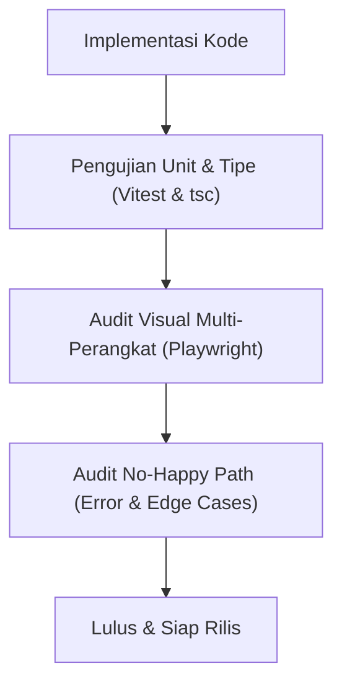

# Panduan & Rekomendasi Eksekusi Pembaharuan Desain v2

Disusun pada 26 Oktober 2026 sebagai peta jalan operasional dan teknis untuk mengeksekusi paket rancangan antarmuka pada `docs/pembaharuan-desain/` ke dalam basis kode Daily Dose Pilates v2.

---

## 1. Ringkasan Eksekutif

Paket dokumen pembaharuan desain (`00-README`, `01-PROMPT`, `02-SPEC`, `03-BACKLOG`) menyajikan audit tajam terhadap pengalaman pengguna di `v2.dailydosepilates.com`. Sasaran intinya adalah:
1. **Member usia 45–55 tahun:** Mengutamakan kemudahan (maksimal 3 tap dari buka aplikasi sampai kelas terbooking), keterbacaan (teks utama 17 px, target sentuh minimal 44 x 44 px, kontras WCAG 3:1+ untuk border), dan penghapusan seluruh jargon teknis/kode internal.
2. **Instruktur studio:** Akses kilat 1–2 tap untuk melihat kelas hari ini, daftar peserta, dan scan presensi mandiri tanpa dibebani kontrol administratif studio.
3. **Integritas sistem:** Menghilangkan data dummy, angka nol dekoratif, serta memastikan konsistensi navigasi mobile dan tablet.

Panduan ini merinci langkah-langkah implementasi praktis mulai dari pra-syarat keputusan bisnis, penyelarasan fondasi desain, hingga pembagian kerja tiket gelombang demi gelombang.

---

## 2. Fase 0: Penyelarasan Keputusan Bisnis & Prasyarat Data (Pre-requisites)

Sebelum penulisan kode antarmuka dimulai, terdapat 5 prasyarat yang harus diselesaikan bersama pemilik studio/manajemen:

| No | Bidang Keputusan | Kondisi Saat Ini | Rekomendasi Solusi |
|---|---|---|---|
| **0.1** | **Keamanan Tablet Kiosk (T-12)** | Rute `/kiosk` terbuka bebas di footer dengan URL mudah ditebak. | **Rekomendasi:** Lepas link dari footer publik. Pasang PIN otorisasi cabang (misal 6 digit per studio) atau pairing token lokal pada tablet studio, serta rotasi QR dinamis tiap 60 detik. |
| **0.2** | **Kewajiban KTP Member Lama (T-02, T-09)** | Sistem mewajibkan KTP sebelum booking, sementara member lama merasa dipersulit. | **Rekomendasi:** Member lama yang diimpor dari data cabang ditandai status `VERIFIED_BY_STUDIO` secara otomatis oleh Admin Front Desk. Verifikasi KTP mandiri hanya diwajibkan untuk member baru saat pembelian paket pertama. |
| **0.3** | **Rekening Pembayaran Resmi (T-07)** | Nominal transfer butuh kejelasan rekening tujuan. | **Rekomendasi:** Tentukan nama bank resmi (misal: BCA / Mandiri), nomor rekening cabang/holding, dan nama pemilik rekening resmi yang baku untuk disematkan pada sistem checkout manual. |
| **0.4** | **Kanal Notifikasi WhatsApp (B-06, T-09)** | Pengingat jadwal dan notifikasi sistem baru tersimpan di database/log tanpa gateway. | **Rekomendasi:** Tentukan penyedia WhatsApp Business API (WABA / vendor gateway). Jika belum siap, pertahankan alur login nomor HP + password yang sudah rapi, dan hilangkan klaim "Kode dikirim via WhatsApp" pada tampilan. |
| **0.5** | **Pengisian Data Jadwal Kelas di Staging/Dev** | Jadwal kelas kosong sejak 9 Oktober 2026 di 5 cabang. | **Rekomendasi:** Jalankan seed atau input minimal 5 sesi kelas per cabang untuk 7 hari ke depan agar pengujian 3-tap booking, QR Pass, dan presensi dapat diuji nyata. |

---

## 3. Fase 1: Fondasi Arsitektur & Penyelarasan Token Desain

### 3.1 Pembaruan Master Prompt (`01-PROMPT-UNTUK-LLM-DEVELOPER.md`)
Lengkapi placeholder teknis pada master prompt agar siap dipakai oleh AI developer:
- **Framework:** Next.js 15 (App Router), React 19, TypeScript strict mode.
- **Styling:** Tailwind CSS dengan ekstensi token *Editorial Calm* (`ed-*`) dan token studio (`dd-*`).
- **State & Data Fetching:** React Hooks, TanStack Query / SWR / Fetch Client terstandarisasi di `apps/web/app/api-clients/`.
- **Form & Validasi:** Native HTML5 + Zod / custom typed validator dengan aksesibilitas ARIA lengkap.

### 3.2 Konsolidasi Token Warna & Kontras WCAG (T-15)
- **Border Komponen Interaktif:** Terapkan `#768b84` (rasio kontras 3.62:1 pada putih, lolos WCAG 3:1) untuk seluruh input, kartu yang dapat diklik, tombol sekunder, dan date-picker. Gantikan `#d5dfda` yang hanya mencapai rasio 1.36:1 (hanya boleh untuk garis pemisah pasif).
- **Tipografi:** Teks utama ditingkatkan ke 17 px (DM Sans / Inter), judul bagian 20 px (Poppins 600), dan judul halaman 28 px. Tidak ada teks yang berukuran di bawah 13 px.
- **Target Sentuh:** Minimal 44 x 44 px dengan jarak renggang minimal 12 px antar elemen interaktif.
- **Fokus Keyboard:** Lingkar fokus tegas 3 px `#24483a` dengan offset 2 px.

### 3.3 Kamus Pemetaan Bahasa Bebas Jargon (T-13)
Buat modul pemetaan terpusat `apps/web/app/lib/system-dictionary.ts` yang menerjemahkan kode internal menjadi kosakata manusia:
- `ALL_LEVELS` &rarr; "Semua Level"
- `PRIVATE_GROUP` &rarr; "Private Group"
- `PRIVATE` &rarr; "Private"
- `SEMI_PRIVATE` &rarr; "Semi Private"
- `DD-GG` &rarr; "Daily Dose Green Garden"
- `DD-MK` &rarr; "Daily Dose Muara Karang"
- `DD-SBY` &rarr; "Daily Dose Graha Family Surabaya"
- `DD-PIK2` &rarr; "Daily Dose Orange Groves PIK 2"
- `DD-UNTAR` &rarr; "Daily Dose Untar Kampus 2"
- `Asia/Jakarta` &rarr; "WIB"
- `KYC` &rarr; "Verifikasi Identitas"
- `CUSTOMER_VERIFICATION_REQUIRED` &rarr; "Identitas kamu belum diverifikasi. Lengkapi verifikasi terlebih dahulu (sekitar 2 menit)."

---

## 4. Fase 2: Eksekusi Tiket Gelombang 1 — Alur Kritis Member

Fokus: Menghilangkan hambatan yang menyebabkan calon member dan member aktif berhenti di tengah jalan.

### Tiket T-01: Terjemahkan Penolakan Verifikasi di Checkout
- **File:** `apps/web/app/checkout/checkout-view.tsx` & `apps/web/app/api-clients/order-client.ts`.
- **Pekerjaan:** Tangkap kode `CUSTOMER_VERIFICATION_REQUIRED` dari API, tampilkan kartu penolakan yang ramah: *"Pembelian paket belum bisa diproses. Identitas kamu belum diverifikasi. Isi data verifikasi dulu, sekitar 2 menit."* dengan tombol `Isi data verifikasi` yang menyertakan parameter `returnTo` kembali ke checkout.
- **Kriteria Selesai:** Tidak ada pesan teknis umum seperti *"Paket belum tersedia. Layanan pesanan belum dapat memproses..."*.

### Tiket T-02: Banner Status Verifikasi di Beranda Member
- **File:** `apps/web/app/account/page.tsx` (atau beranda member) & `apps/web/app/components/mobile-bottom-navigation.tsx`.
- **Pekerjaan:** 
  1. Tampilkan banner status di bawah header beranda:
     - Belum verifikasi (Info biru muda `#e8f3f8`, tombol `Isi data verifikasi`).
     - Sedang diperiksa (Kuning `#fff4da`, *"Data kamu sedang diperiksa tim studio"*).
     - Ditolak (Merah lembut `#faeceb`, mencantumkan alasan penolakan dan tombol `Perbaiki data`).
  2. Hentikan silent redirect pada tab Booking dan Pesanan. Kedua tab tetap dapat dibuka dan menampilkan kartu penjelasan status yang ramah.
- **Kriteria Selesai:** Member mengetahui status akunnya secara transparan tanpa dialihkan mendadak.

### Tiket T-03: Satu Sistem Navigasi Konsisten
- **File:** `apps/web/app/application-shell.tsx`, `apps/web/app/components/mobile-bottom-navigation.tsx`, dan `apps/web/app/public-landing.tsx`.
- **Pekerjaan:**
  1. Member yang sudah memiliki sesi login aktif ketika membuka root URL (`/`) otomatis diarahkan ke dashboard/beranda member.
  2. Bottom Navigation Mobile Customer dibakukan 5 item: **Beranda | Jadwal | Booking | Paket | Akun**.
  3. Menu *Pesanan* dipindahkan ke dalam submenu *Akun* (namun pesanan berstatus menunggu transfer tetap disorot di Beranda).
  4. Setiap halaman dilengkapi header konsisten, tombol kembali 44 x 44 px, dan `<title>` browser yang spesifik per halaman (misal: *"Jadwal Kelas - Daily Dose Pilates"*).
- **Kriteria Selesai:** Bottom bar tidak pernah hilang di halaman member, tidak ada halaman yang berlabel generik *"Move with intention"*.

### Tiket T-04: Rombak Total Halaman Jadwal Kelas
- **File:** `apps/web/app/classes/public-classes-view.tsx`.
- **Pekerjaan:**
  1. Header ringkas 56 px dengan baris 7 pil tanggal horizontal di bawahnya (format: nama hari di atas, angka tanggal di bawah). Konten pertama wajib terlihat di atas `y = 400 px` pada layar 375 px.
  2. Filter ringkas sejajar: `Studio: [Nama Studio Utama]` dan `Tipe Kelas: Semua`.
  3. Mengganti tanggal atau filter langsung memperbarui daftar sesi via API/State tanpa memuat ulang (*reload*) halaman.
  4. Sesi penuh tetap tampil namun disabled dengan label jelas: `Penuh, 0 slot` (warna `#8a5b17`).
- **Kriteria Selesai:** Pemilihan jam kelas langsung terlihat di layar pertama tanpa harus menggulir jauh, kode `DD-` hilang sepenuhnya.

### Tiket T-05: Konfirmasi Booking Berbasis Bottom Sheet (3-Tap Flow)
- **File:** `apps/web/app/classes/public-classes-view.tsx` & komponen modal/sheet.
- **Pekerjaan:**
  1. Hapus halaman perantara *"Pilih jadwal kelas terlebih dahulu"*.
  2. Tap sesi langsung memunculkan Bottom Sheet konfirmasi (maksimal 80% tinggi layar): memuat nama kelas, hari/tanggal/jam, instruktur, studio, sisa slot, dan kuota paket yang akan berkurang.
  3. Tombol aksi `Konfirmasi booking sekarang` mengeksekusi locking kuota atomik di backend.
  4. Sheet bertransisi ke status berhasil di tempat yang sama dengan opsi `Lihat QR Pass` dan `Tutup`.
- **Kriteria Selesai:** Member dapat menyelesaikan booking tepat dalam 3 tap. Skenario perebutan slot terakhir tertangani dengan graceful feedback.

---

## 5. Fase 3: Eksekusi Tiket Gelombang 2 — Optimalisasi Pembelian & Penggunaan

Fokus: Mempercepat pemilihan paket, kemudahan transfer bank, dan akses check-in.

### Tiket T-06: Rombak Halaman Paket Sesi
- **File:** `apps/web/app/packages/public-packages-view.tsx`.
- **Pekerjaan:**
  1. Hapus 5 kartu cabang berukuran besar di atas halaman; ganti dengan tombol pemilih studio ringkas.
  2. Tambahkan opsi pengurutan: `Termurah per sesi`, `Sesi terbanyak`, dan `Paling sering dibeli`.
  3. Kelompokkan kartu paket ke dalam dua seksi: `Coba Dulu (1-3 Sesi)` dan `Paket Rutin (5 Sesi ke Atas)`.
  4. Tampilkan fakta esensial: harga total, harga per sesi, masa berlaku, dan badge `TERMURAH PER SESI`.
  5. Sembunyikan otomatis paket promo yang periodenya sudah lewat dari tanggal hari ini.
- **Kriteria Selesai:** Kartu paket pertama terlihat di layar pertama (di atas 500 px), nama paket tidak terpotong di tengah kata.

### Tiket T-07: Halaman Pembayaran dengan Tombol Salin
- **File:** `apps/web/app/orders/orders-view.tsx` & `apps/web/app/orders/[id]/page.tsx`.
- **Pekerjaan:**
  1. Susun 2 langkah jelas: `Langkah 1: Transfer Tepat Sejumlah Ini` dan `Langkah 2: Unggah Bukti Transfer`.
  2. Tampilkan nominal unik dengan ukuran 30 px Poppins 600, dilengkapi tombol `Salin nominal`.
  3. Tampilkan nomor rekening resmi studio dengan tombol `Salin nomor rekening`.
  4. Berikan indikator visual (*toast / feedback*) saat tombol salin ditekan.
  5. Sematkan countdown batas waktu transfer berdasarkan timestamp server aktual.
- **Kriteria Selesai:** Member tidak perlu mengetik ulang nominal 10 digit atau nomor rekening secara manual.

### Tiket T-08: QR Pass Satu Tap dari Beranda
- **File:** `apps/web/app/account/page.tsx` & `apps/web/app/check-in-pass/page.tsx`.
- **Pekerjaan:**
  1. Tempatkan kartu *Booking Terdekat* di posisi paling atas Beranda Member, lengkap dengan tombol `Lihat QR Pass`.
  2. Halaman QR Pass menggunakan kanvas gelap elegan (`#24483a`) dengan kartu putih kontras tinggi yang membungkus QR code berukuran minimal 230 px.
  3. Sertakan detail ringkas: nama kelas, jam, studio, instruktur, nama member, dan masa berlaku kode.
- **Kriteria Selesai:** Dari beranda ke tampilan QR code yang siap dipindai mesin kiosk tercapai dalam 1 tap.

### Tiket T-09: Penyelarasan Alur Pendaftaran Akun
- **File:** `apps/web/app/register/register-view.tsx`.
- **Pekerjaan:**
  1. Pertahankan konsistensi responsive yang sudah diperbaiki: Nama lengkap, Nomor WhatsApp, Email, Password, Ulangi Password.
  2. Unggah dokumen KTP dan Selfie diberi keterangan jelas bahwa langkah ini bersifat **opsional saat pendaftaran** dan dapat dilengkapi saat pembelian paket pertama.
  3. Tambahkan callout bantuan untuk member lama: *"Sudah pernah berlatih di studio? Akun Anda mungkin sudah terdaftar oleh staf front desk. Silakan hubungi admin atau masuk menggunakan nomor WhatsApp terdaftar."*
- **Kriteria Selesai:** Pendaftaran akun cepat, tidak membingungkan member baru, dan tidak ada error layout horizontal.

---

## 6. Fase 4: Eksekusi Tiket Gelombang 3 — Portal Instruktur & Studio Kiosk

Fokus: Efisiensi kerja instruktur dan presensi otomatis di studio.

### Tiket T-10: Beranda Khusus Instruktur & Pembatasan Peran
- **File:** `apps/web/app/workspace/classes/` & `apps/web/app/instructors/`.
- **Pekerjaan:**
  1. Saat akun dengan peran tunggal Instruktur masuk, arahkan default ke tab `Hari Ini` (bukan dasbor admin umum).
  2. Bottom navigation instruktur dibatasi 4 item: **Hari Ini | Jadwal Saya | Scan | Akun**.
  3. Sembunyikan seluruh kontrol administrasi cabang (tombol *"Buat kelas"*, manipulasi jadwal, atau data pembayaran peserta).
  4. Dropdown cabang hanya menampilkan cabang penugasan instruktur yang bersangkutan (jika hanya 1 cabang, sembunyikan dropdown).
- **Kriteria Selesai:** Instruktur langsung melihat jadwal mengajarnya hari ini dalam 1 tap tanpa melihat fitur yang tidak memiliki izin akses (403).

### Tiket T-11: Pemindai QR Presensi Instruktur
- **File:** `apps/web/app/check-in-scanner/scanner-view.tsx`.
- **Pekerjaan:**
  1. Kamera langsung aktif saat halaman scanner dibuka dengan auto-shutter saat mendeteksi QR kiosk studio.
  2. Ganti seluruh instruksi teknis (*"Paste payload dd-checkin:v1:..."*) menjadi instruksi natural: *"Arahkan kamera ke layar tablet studio untuk mencatat presensi mengajar."*
  3. Sembunyikan kolom input teks manual di balik accordion/tautan bantuan *"Tidak bisa memindai QR?"*.
- **Kriteria Selesai:** Instruktur menyelesaikan presensi mengajar maksimal dalam 2 tap.

### Tiket T-12: Antarmuka Tablet Kiosk Studio & Integrasi Geofence
- **File:** `apps/web/app/kiosk/kiosk-view.tsx`.
- **Pekerjaan:**
  1. Terapkan tata letak horizontal (landscape 1024 x 768 px) yang dapat dibaca jelas dari jarak 2 meter.
  2. Sisi kiri: QR presensi dinamis (minimal 280 px) yang berputar secara otomatis dengan masa berlaku 60 detik.
  3. Sisi kanan: Informasi jam besar, sesi kelas berikutnya, nama instruktur, dan daftar presensi masuk hari ini.
  4. Integrasikan verifikasi validasi Geofence Leaflet cabang (radius kehadiran) yang sudah dibangun di backend.
- **Kriteria Selesai:** QR hasil screenshot tidak dapat dipakai setelah masa berlaku habis, informasi terbaca jelas dari jarak 2 meter.

---

## 7. Fase 5: Eksekusi Tiket Gelombang 4 — Kebersihan Sistem & UI Polish

### Tiket T-13: Penerapan Kamus Terpusat Bebas Jargon
- Audit seluruh file tampilan di `apps/web/app/` menggunakan kamus `system-dictionary.ts`.
- Pastikan tidak ada string mentah seperti `ALL_LEVELS`, `PRIVATE_GROUP`, `Asia/Jakarta`, `KYC`, atau kode cabang yang bocor ke antarmuka.

### Tiket T-14: Standarisasi 3 Keadaan Layar Data (Empty, Loading, Error)
- Setiap komponen daftar data wajib memiliki 3 status terstandarisasi:
  - **Kosong:** Menjelaskan penyebab dan menyertakan 1 tombol aksi (misal: *"Belum ada paket aktif. Beli paket sekarang"*). Menghapus tulisan pasif *"Tidak ada data"*.
  - **Memuat:** Menampilkan skeleton berbayang tenang tanpa animasi denyut agresif (*motion-reduce aware*).
  - **Error:** Menyebutkan penyebab kesalahan dan tombol *"Coba muat ulang"*.

### Tiket T-15 & T-16: Pengujian Kontras Aksesibilitas & Sanitasi Status
- Seluruh elemen interaktif terukur minimal 3:1 terhadap latarnya.
- Paket kedaluwarsa dipindahkan ke tab riwayat (tombol aksi berubah menjadi `Beli paket baru`).
- Tanggal booking wajib menyertakan tahun jika bukan tahun kalender berjalan.
- Penghitung pesanan diperbaiki menjadi *"Menampilkan 1 pesanan"* (bukan *"Menampilkan 1 dari 0 pesanan"*).

---

## 8. Protokol Verifikasi & Quality Assurance (QA)

Setiap tiket yang dikerjakan wajib lolos 4 tahap verifikasi sebelum dianggap selesai:



1. **Automated Unit Tests (`Vitest`):**
   - Menjalankan seluruh unit test terkait form, kalkulasi tanggal, dan validasi:
     ```bash
     pnpm --filter @dailydose/web test
     ```
2. **TypeScript Strict Typecheck:**
   - Memastikan tidak ada error tipe:
     ```bash
     pnpm --filter @dailydose/web typecheck
     ```
3. **Audit Multi-Perangkat (Playwright Headless Chrome):**
   - Wajib diuji pada 4 ukuran layar:
     - **Mobile Kecil:** 360 x 740 px (Android / small screen).
     - **Mobile Standar:** 390 x 844 px (iPhone).
     - **Tablet Portrait:** 768 x 1024 px (iPad Mini / Kiosk).
     - **Tablet Landscape / Desktop:** 1024 x 768 px & 1280 x 800 px.
   - Memastikan tidak ada horizontal scrollbar atau clipping card.
4. **No-Happy Path Testing:**
   - Uji input kosong, koneksi terputus, batas waktu transfer habis, saldo sesi habis, dan perebutan slot kelas terakhir.

---

## 9. Matriks Linimasa & Alokasi Pengerjaan

| Fase | Cakupan Tiket | Estimasi Waktu | Deliverable Utama |
|---|---|:---:|---|
| **Fase 0** | Keputusan Bisnis & Seeding Data | 1–2 Hari Kerja | Dokumen keputusan disetujui, jadwal kelas aktif terisi di 5 cabang. |
| **Fase 1** | Prompt LLM, Token Kontras & Kamus Bebas Jargon | 1–2 Hari Kerja | `system-dictionary.ts`, update token Tailwind `#768b84` & 17 px font. |
| **Fase 2** | Gelombang 1: Jalur Kritis Member (T-01 s/d T-05) | 4–6 Hari Kerja | 3-tap booking flow, Bottom Sheet, perbaikan jadwal kelas & banner verifikasi. |
| **Fase 3** | Gelombang 2: Paket, Bayar & QR (T-06 s/d T-09) | 3–5 Hari Kerja | Sortir paket sesi, halaman transfer tombol salin, QR Pass 1-tap. |
| **Fase 4** | Gelombang 3: Instruktur & Kiosk (T-10 s/d T-12) | 3–4 Hari Kerja | Portal instruktur `Hari Ini`, scanner natural, tablet kiosk landscape. |
| **Fase 5** | Gelombang 4: Kebersihan Sistem & QA (T-13 s/d T-16) | 2–3 Hari Kerja | Eliminasi jargon teknis, skeleton loader, audit WCAG kontras. |
| **Total** | **16 Tiket Backlog Menyeluruh** | **~3 Minggu Kerja** | **Sistem Web Mobile & Tablet v2 Siap Produksi Penuh** |
