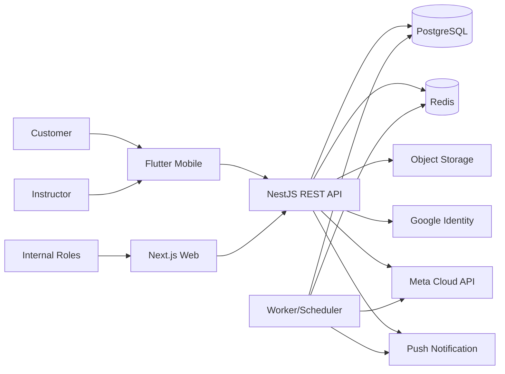

# Solution Architecture

**Status:** DRAFT  
**Architecture owner:** Backend Lead / Technical Lead

Keputusan rinci dan status approval berada pada [Architecture Decision Baseline](03-architecture-decision-baseline.md). ERD/data dictionary dan kontrak API berada pada [Data Dictionary & ERD](04-data-dictionary-and-erd.md), [API/Event/Security Contract](05-api-event-security-contract.md), dan [OpenAPI v1](openapi-v1.yaml).
Draft scope/checksum/consumer compatibility Sprint 2–3 berada pada [Sprint 2–3 Contract Manifest](06-sprint-2-3-contract-manifest.md); manifest tidak menggantikan Gate 4 approval.

## 1. Context dan Container



Satu NestJS modular monolith menyediakan versioned REST API bagi Next.js dan Flutter. Worker menggunakan codebase/domain contract yang sama dan dipisahkan sebagai process/deployment bila diperlukan.

## 2. Technology Baseline

| Layer | Pilihan |
|---|---|
| Web | Next.js App Router, TypeScript, Tailwind, component library, TanStack Query/Table, React Hook Form + Zod |
| Mobile | Flutter, feature-first MVVM, Riverpod, GoRouter, Dio, Freezed/json_serializable, secure storage |
| API | NestJS, TypeScript, REST JSON, OpenAPI 3.x, validation/serialization/guards/interceptors |
| Data | PostgreSQL, Prisma baseline dengan SQL migration review untuk constraint/query kritis |
| Async | Redis + BullMQ-compatible queue/scheduler |
| Files | Private object storage, signed URL, antivirus/content validation pipeline |
| Auth | Google OIDC/OAuth; OTP WhatsApp; application RBAC/branch assignment |
| Messaging | Meta Cloud API adapter dan push/in-app notification |
| Observability | Structured logs, metrics, tracing/correlation ID, alerting/error tracking |
| Delivery | Containerized environment, CI/CD, managed secret store, IaC setelah provider dipilih |

Versi dependency dipin saat scaffold melalui ADR dan lockfile; dokumen ini tidak mengunci nomor versi yang cepat usang.

## 3. Backend Module Boundaries

- `identity-access`: external identities, sessions/tokens, OTP, MFA, role, branch authorization.
- `branches-master`: Branch, ClassType, Package definitions, effective-dated setting.
- `customers-packages`: Customer, purchase proof, approval, CustomerPackage, expiry.
- `session-ledger`: append-only ledger, reservation, available balance, adjustment.
- `instructors`: branch assignment, availability, fee.
- `classes`: ClassSlot lifecycle, timetable, assignment, quota evaluation.
- `bookings`: booking, reschedule, capacity/reservation transaction.
- `attendance`: Instructor/Customer check-in, backfill, completion, InstructorHourLog.
- `finance`: revenue, projection, realtime, OtherCost, MonthlyClose, CorrectionJournal.
- `notifications`: occurrence, provider adapter, template, retry, delivery status.
- `audit`: immutable audit event/query.
- `operations`: health, scheduler/queue monitoring, admin-safe diagnostics.

Modul berkomunikasi melalui exported application service/domain event, bukan membaca private table/module implementation secara sembarang.

## 4. Data dan Command Flow Kritis

### Package Approval

1. Authorize approver dan branch.
2. Lock/validate pending purchase dan active Package snapshot.
3. Buat CustomerPackage, activation/expiry, sale/projection snapshot.
4. Append `PURCHASE` ledger entry.
5. Tulis audit dan transactional outbox event.
6. Commit; worker mengirim notification dari outbox.

### Booking

1. Validate idempotency key, package status/class/branch/time.
2. Dalam transaction, lock/serialize capacity dan package reservation scope.
3. Pastikan `available session ≥1` dan seat tersedia.
4. Buat Booking dan SessionReservation unik.
5. Tulis audit/outbox bila assisted booking.

Database constraint dan transaction menjadi pertahanan concurrency; pengecekan UI/API awal hanya meningkatkan UX.

### Class Completion

1. Lock ClassSlot dan pastikan `CONFIRMED` serta completion belum diposting.
2. Untuk setiap attended booking, append satu `ATTEND` dan consume reservation.
3. Untuk matched instructor check-in, buat satu InstructorHourLog.
4. Set `COMPLETED`, tulis audit/outbox, commit.

### Monthly Close

1. Authorize, lock BranchPeriod, jalankan pre-close validation.
2. Hitung/simpan snapshot revenue/projection/realtime/other/profit.
3. Set `LOCKED`, audit/outbox, commit.
4. Subsequent mutation memeriksa period lock pada service dan database guard/constraint yang applicable.

## 5. State Machines

```text
ClassSlot:
DRAFT -> PUBLISHED -> CONFIRMED -> COMPLETED
                  \-> AUTO_CANCELLED
DRAFT/PUBLISHED/CONFIRMED -> CANCELLED_MANUAL (authorized + reason)

Purchase:
PENDING -> APPROVED
        \-> REJECTED

Booking:
ACTIVE -> ATTENDED
       -> RESCHEDULED
       -> CANCELLED_CUSTOMER
       -> AUTO_CANCELLED
       -> NO_SHOW

SessionAdjustRequest:
PENDING -> APPROVED -> POSTED
        \-> REJECTED

BranchPeriod:
OPEN -> CLOSING -> LOCKED
```

Transisi hanya melalui command endpoint; direct status update tidak diperbolehkan.

## 6. Architecture Decision Records

ADR minimum sebelum build:

- ADR-001 Modular monolith dan module boundaries.
- ADR-002 REST/OpenAPI dan generated clients.
- ADR-003 Prisma/SQL migration strategy.
- ADR-004 Ledger/reservation/concurrency model.
- ADR-005 Auth session/token dan MFA implementation.
- ADR-006 Queue/scheduler/outbox/idempotency.
- ADR-007 Cloud, region, networking, storage, backup.
- ADR-008 Observability dan PII-safe logging.
- ADR-009 Deployment/rollback strategy.

ADR berisi context, options, decision, consequences, owner, date, dan superseded link.

## 7. Environment dan CI/CD

- `local`: synthetic data; container dependencies.
- `development`: shared integration, no production data.
- `staging`: production-like, masked/synthetic UAT data, migration rehearsal.
- `production`: restricted access, approval gate, monitoring/backup.

Pipeline minimum: lint → static/type analysis → unit → integration/API → build → dependency/secret scan → deploy staging → smoke/e2e → approval → production canary/rolling → post-deploy smoke.

Database migration wajib backward-compatible untuk rolling deploy atau menggunakan documented maintenance window. Rollback aplikasi tidak boleh mengasumsikan destructive schema rollback.
