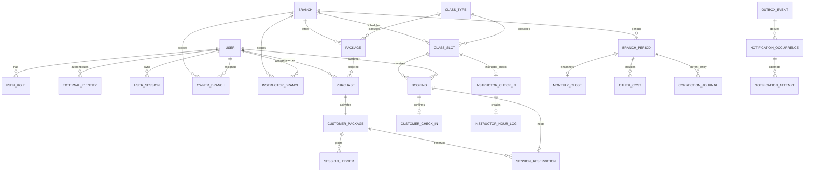

# Data Dictionary, ERD & Invariants

**Status:** DRAFT  
**Owner/approver:** Technical Lead

Conventions: UUID primary keys; `created_at/updated_at` UTC `timestamptz`; money `bigint` integer Rupiah with `>=0` unless a signed journal amount is explicit; user-entered text length-limited and sanitized on output; branch-scoped tables carry `branch_id`; transactional history is restrictive-delete.

## 1. ERD

## 2. Identity and Organization

| Entity | Required fields and types | Constraints/indexes/lifecycle |
|---|---|---|
| User | `id`, `customer_id?`, `display_name varchar(160)`, `email? citext`, `phone_e164? varchar(20)`, `status UserStatus`, `stopped_at?`, timestamps | unique verified identity handled in ExternalIdentity; status ACTIVE/INACTIVE/STOPPED; no hard-delete with history |
| ExternalIdentity | `id,user_id,provider,subject,verified_email?,verified_phone?,created_at` | unique `(provider,subject)`; linking only verified flow |
| UserRole | `id,user_id,role,active_from,active_until?` | no overlapping duplicate active role; role enum CUSTOMER/INSTRUCTOR/ADMIN/MANAGER/OWNER/SUPER_OWNER/FINANCE/OPS |
| UserMfa | `id,user_id,method,status,enrolled_at,last_verified_at?` | secrets encrypted/managed reference; never returned |
| UserSession | `id,user_id,channel,token_family_hash,assurance,expires_at,revoked_at?` | index user/expiry; token hash only |
| Branch | `id,code,name,timezone,status` | unique code; IANA timezone; timezone change requires migration plan |
| OwnerBranch / InstructorBranch | `id,user_id,branch_id,active_from,active_until?` | non-overlapping active assignment; unique active business key |
| ClassType | `id,code,name,status` | unique code; soft deactivate |

## 3. Package, Ledger and Booking

| Entity | Required fields and types | Constraints/indexes/lifecycle |
|---|---|---|
| Package | `id,branch_id,class_type_id,name,session_count int,duration_days int,price_rp bigint,status,effective_from,to?` | positive counts/duration; non-overlap active name/version key; soft deactivate |
| Purchase | `id,branch_id,customer_user_id,package_id,status,submitted_at,decided_at?,decided_by?,reason?,idempotency_ref?` | PENDING→APPROVED/REJECTED; unique approval result; branch index |
| PaymentProof | `id,purchase_id,object_key,mime,size_bytes,sha256,scan_status,uploaded_by` | private unique object key; CLEAN required for review; retention policy |
| CustomerPackage | `id,branch_id,customer_user_id,package_id,purchase_id,activation_date,expiry_at,sale_price_rp,session_count_snapshot,duration_snapshot,projection_rate_rp` | unique purchase; immutable commercial snapshots; status derived/ACTIVE/EXPIRED |
| SessionLedger | `id,branch_id,customer_package_id,type,quantity int,reference_type,reference_id,approved_by?,reason?,occurred_at` | nonzero quantity; unique `(customer_package_id,type,reference_type,reference_id)`; append-only DB privilege/policy |
| SessionReservation | `id,branch_id,customer_package_id,booking_id,status,created_at,released_at?,consumed_at?` | unique booking; at most one ACTIVE per booking; no active reservation on expired package |
| SessionAdjustRequest | `id,branch_id,customer_package_id,quantity,reason,requested_by,approved_by?,status` | quantity nonzero; requested_by != approved_by; PENDING transitions only |
| Booking | `id,branch_id,class_slot_id,customer_user_id,customer_package_id,status,source,created_by` | unique active `(slot,customer)`; indexed slot/status and customer/status |
| Reschedule | `id,branch_id,booking_id,target_slot_id,reason,requested_at,cutoff_class,status,decided_by?` | one active pending request per booking; atomic result |

## 4. Scheduling and Attendance

| Entity | Required fields and types | Constraints/indexes/lifecycle |
|---|---|---|
| InstructorAvailability | `id,branch_id,instructor_user_id,start_at,end_at,status` | end>start; prevent approved overlap for instructor |
| ClassSlot | `id,branch_id,class_type_id,instructor_user_id?,start_at,end_at,quota_snapshot,capacity_snapshot,status,version` | end>start; capacity>=quota>=1; instructor overlap constraint/service lock; optimistic version |
| InstructorCheckIn | `id,branch_id,class_slot_id,instructor_user_id,checked_at,token_jti_hash,match_status` | unique slot/instructor and token JTI; no raw token |
| CustomerCheckIn | `id,branch_id,class_slot_id,booking_id,customer_user_id,method,checked_at,backfill_by?,reason?` | unique booking; ADMIN_BACKFILL requires actor/reason |
| InstructorHourLog | `id,branch_id,class_slot_id,instructor_user_id,class_type_id,hours decimal(5,2),fee_rp,effective_fee_id,period` | MVP hours=1; unique slot/instructor; immutable fee snapshot |

## 5. Effective Master and Finance

| Entity | Required fields and types | Constraints/indexes/lifecycle |
|---|---|---|
| InstructorFee | `id,branch_id,instructor_user_id,class_type_id,fee_rp,effective_from,to?` | non-negative; exclusion/non-overlap business key |
| ProjectionRate | `id,branch_id,class_type_id,rate_rp,effective_from,to?` | non-negative; non-overlap business key |
| MinQuotaSetting | `id,branch_id,class_type_id,minimum,default_capacity,effective_from,to?` | `capacity>=minimum>=1`; non-overlap key |
| BranchPeriod | `id,branch_id,period_month,status,version,locked_at?,locked_by?` | unique branch/month; OPEN→CLOSING→LOCKED |
| OtherCost | `id,branch_period_id,description,amount_rp,evidence_key?,created_by` | period must OPEN; positive amount; audited |
| MonthlyClose | `id,branch_period_id,revenue_rp,projection_rp,realtime_rp,other_rp,profit_rp,control_hash,closed_by,closed_at` | unique period; profit=revenue-projection-other; immutable snapshot |
| CorrectionJournal | `id,current_branch_period_id,reference_period_id,amount_rp,reason,requested_by,approved_by,status` | current period OPEN; reference period LOCKED; self-approval denied |

## 6. Platform and Migration

| Entity | Required fields and types | Constraints/indexes/lifecycle |
|---|---|---|
| AuditLog | `id,actor_user_id?,actor_role,action,object_type,object_id,branch_id?,reason?,before_safe?,after_safe?,source,occurred_at,correlation_id,request_id` | application append-only; indexed branch/time, actor/time, object; PII allowlist |
| OutboxEvent | `id,type,aggregate_type,id,payload_version,payload,occurred_at,published_at?,attempts` | deterministic event ID; pending index; payload excludes secrets |
| IdempotencyRecord | `id,actor_scope,operation,key_hash,request_hash,status,response_ref,expires_at` | unique actor/operation/key; mismatch rejected |
| NotificationOccurrence | `id,outbox_event_id,recipient_ref,event_type,reference_id,schedule_key,channel,status` | unique recipient/event/reference/schedule/channel |
| NotificationAttempt | `id,occurrence_id,attempt,provider_message_id?,status,error_code?,requested_at,updated_at` | unique occurrence/attempt and provider ID when present |
| MigrationBatch | `id,source_type,source_version,checksum,code_version,status,row_total,accepted,rejected,started_at,finished_at?` | unique source/checksum/target scope; control totals required |
| MigrationReject | `id,batch_id,row_key,reason_code,safe_detail,status,owner?` | no unnecessary PII; remediation trace |

## 7. Database Invariant Verification

Migrations and integration tests must prove unique/foreign/check constraints, append-only privileges, effective-date non-overlap, period-lock enforcement on every finance mutation, booking/capacity locking, ledger reference uniqueness, reservation lifecycle, and branch-scoped query indexes. Service validation improves errors but is never the only defense for money/session/concurrency invariants.

